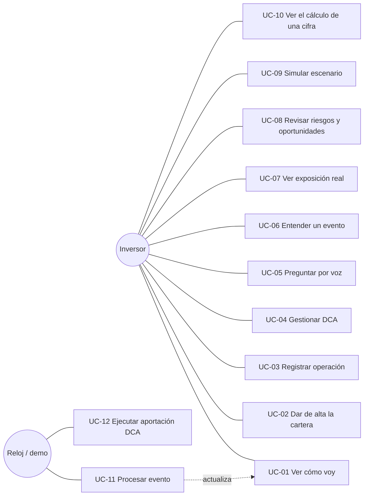
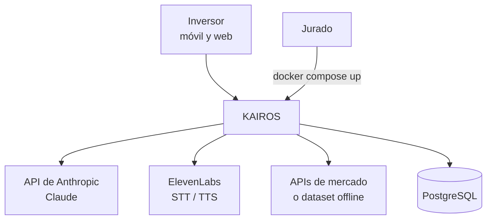
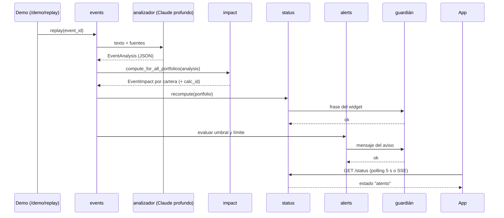
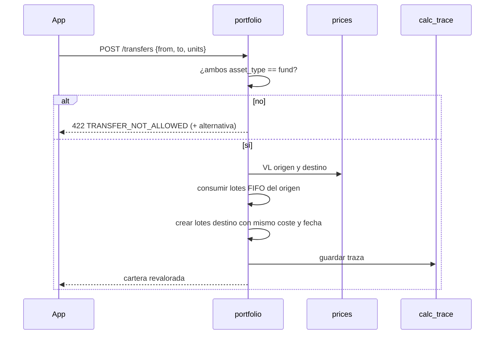
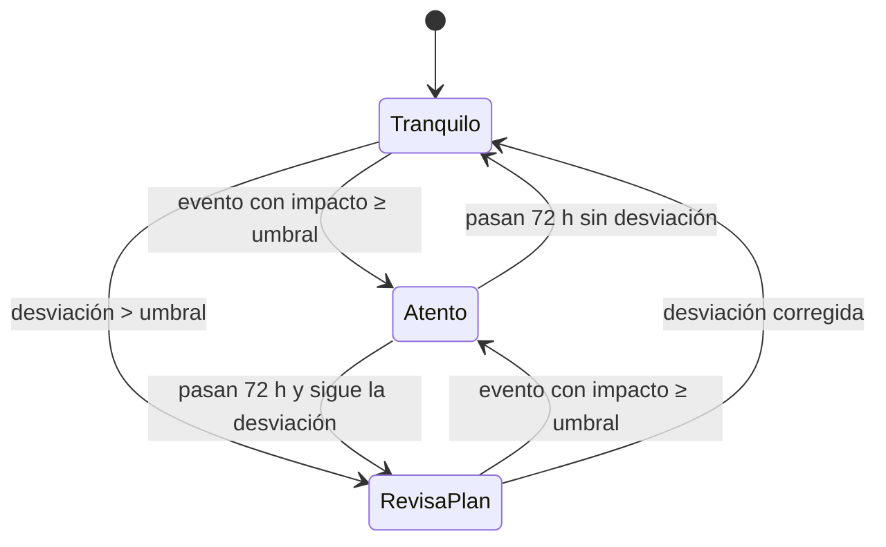
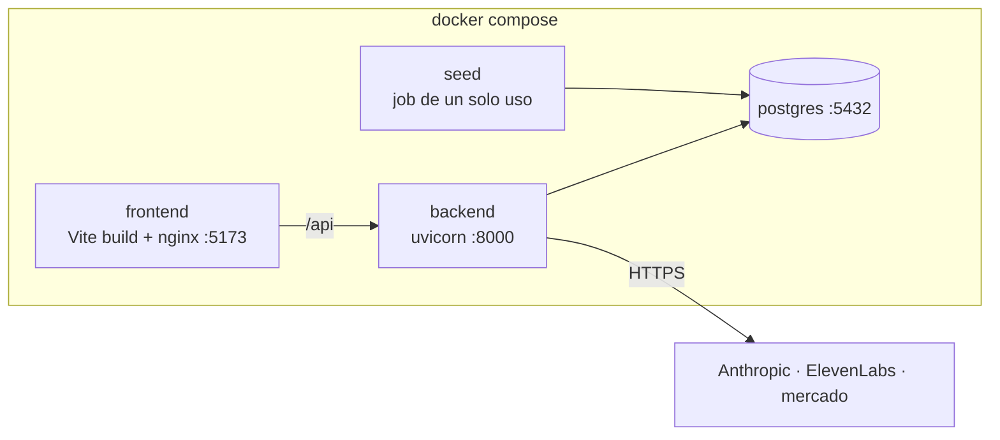

# Documento de ingeniería — KAIROS

Versión 0.1 · 2026-11-08 · Plazo: Dom 8 → Mié 11 23:59 · Documento vivo. Producto: `KAIROS — Idea de proyecto (Hack Finance)`. Detalle técnico en `SPEC.md`.

## Índice

1. Objetivo y alcance
2. Glosario
3. Actores y personas
4. Requisitos funcionales
5. Requisitos no funcionales
6. Casos de uso
7. Diagramas
8. Trazabilidad
9. Plan de pruebas
10. Riesgos técnicos
11. Criterios de aceptación de la demo

---

## 1. Objetivo y alcance

**Objetivo.** Entregar en 4 días una web móvil (widget simulado, app con voz) y un panel web que traduzcan eventos financieros reales al impacto en euros sobre una cartera concreta, sin recomendar operaciones y con cada cifra trazable.

**Dentro del alcance (MVP):** alta de cartera de 6-8 posiciones; compra, venta, traspaso y un plan DCA; precios intradía (acciones/ETF) y VL diario (fondos); look-through de 2-3 fondos/ETF; 3 eventos reales en replay (BCE, petróleo, resultados); motor de impacto por factores; widget con 3 estados; pregunta por voz; panel de contexto; radar de riesgos y oportunidades; guardián.

**Fuera del alcance:** open banking, órdenes reales, noticias en vivo, widget nativo, login y varios usuarios reales, niveles de usuario.

**Criterio de éxito del hackathon:** el guion de demo (§11) funciona de punta a punta el martes 10 a las 23:00 y `docker compose up` + README bastan para que el jurado lo ejecute.

## 2. Glosario

| Término | Significado en KAIROS |
| --- | --- |
| VL | Valor liquidativo: precio diario único de un fondo de inversión |
| DCA | Aportación periódica fija (importe, frecuencia, reparto por activo) |
| Look-through | Ver la composición interna de un fondo/ETF para calcular la exposición real |
| Lote fiscal | Compra concreta con su fecha y coste; base de FIFO y de los traspasos |
| FIFO | Al vender, se consumen primero los lotes más antiguos |
| Traspaso | Mover dinero entre fondos de inversión sin tributar, conservando coste y antigüedad. No aplica a ETF ni acciones |
| Factor | Variable de mercado que explica movimientos: bolsa global, tecnológicas EE. UU., tipos EUR, petróleo, EUR/USD |
| Beta | Sensibilidad de un activo a un factor, estimada por regresión |
| Shock | Movimiento de un factor asociado a un evento |
| Replay | Reproducir un evento real pasado como si ocurriera ahora |
| Guardián | Componente que valida toda salida de IA antes de que llegue al usuario |
| `calc_id` | Identificador de la traza de un cálculo (entradas, salidas, fuentes) |

## 3. Actores y personas

| Actor | Tipo | Interés |
| --- | --- | --- |
| Inversor (Laura, 34, ~40.000 €, RV 76%, DCA 300 €/mes) | Usuario principal | Saber si lo que pasa le afecta y si su plan sigue en pie |
| Inversor próximo a jubilarse (Javier, 58, ~180.000 €, RF 65%) | Usuario secundario | Proteger lo ahorrado; usa sobre todo la voz |
| Jurado | Evaluador | Producto acabado, ejecutable, IA con impacto medible |
| Proveedores externos (Anthropic, ElevenLabs, APIs de mercado) | Sistema | Cuotas, latencia y licencias |
| Reloj / scheduler | Sistema | Dispara DCA y caducidad de estados |

## 4. Requisitos funcionales

Prioridad MoSCoW: **M** = MVP hackathon, **S** = si da tiempo, **C** = después. Dueño según `TABLERO.md`.

| ID | Feature | Requisito | Prio | Dueño | Criterio de aceptación |
| --- | --- | --- | --- | --- | --- |
| RF-01 | F1 | Dar de alta posiciones con ISIN/ticker, participaciones y precio medio; el sistema completa tipo, divisa, clase, TER y traspasable | M | P1 | Alta de 6 posiciones de Laura en < 60 s; tras guardar, `GET /portfolios/{id}` devuelve valor y asignación |
| RF-02 | F1 | Cargar una cartera de ejemplo (Laura o Javier) con un clic | M | P1 | `/demo/reset` deja ambas carteras en su estado inicial |
| RF-03 | F2 | Valorar la cartera con el último precio: intradía para acciones/ETF, VL diario para fondos, todo en € | M | P1 | Cada posición expone `price_at` y `price_kind`; la app muestra "VL a fecha X" |
| RF-04 | F4 | Registrar compra por importe o por participaciones | M | P1 | Precio medio recalculado; test dorado |
| RF-05 | F4 | Registrar venta con FIFO y plusvalía estimada | M | P1 | Rechaza vender más de lo que hay; FIFO verificado con 3 lotes |
| RF-06 | F4 | Registrar traspaso fondo → fondo conservando coste y fecha | M | P1 | ETF/acción → error `TRANSFER_NOT_ALLOWED` con alternativa explicada |
| RF-07 | F5 | Crear, pausar y editar planes DCA; registrar cada aportación al precio del día tras confirmar | M | P1 | `/demo/dca/run` genera ejecución pendiente; confirmar crea `dca_buy` |
| RF-08 | F3 | Calcular exposición por país, sector, divisa y empresa mirando dentro de fondos | M | P2 | Suma de buckets = 100% ± 0,1; indica `coverage_pct` |
| RF-09 | F3/F13 | Detectar empresas repetidas en varias posiciones | M | P2 | Lista solapamientos con peso total en cartera |
| RF-10 | F8 | Calcular impacto en € de un evento por posición y total, con rango, confianza y separación bolsa/divisa | M | P2 | Test dorado Laura/Javier por evento; `calc_id` presente |
| RF-11 | F9 | Reproducir 3 eventos reales (BCE, petróleo, resultados) en modo replay | M | P3 | `/demo/replay/{id}` → evento analizado e impactos calculados en < 10 s |
| RF-12 | F9 | Analizar cada evento a JSON estructurado (tipo, entidades, shocks, cadena causal) | M | P3 | Salida valida contra `EventAnalysis`; se guarda en `event.analysis` |
| RF-13 | F6 | Mostrar estado del widget (tranquilo / atento / revisa tu plan), cifra y frase | M | P2 (back) · P4 (front) | Reglas de §8.6 de SPEC; color + palabra; < 1 s |
| RF-14 | F7 | Pregunta por voz con respuesta hablada de 15-20 s con al menos una cifra en € | M | P3 (agente) · P5 (voz) · P4 (UI) | Primera palabra < 2 s en red del evento; 3 preguntas tipo funcionan |
| RF-15 | F7 | Pregunta por texto con la misma respuesta (plan B y accesibilidad) | M | P3 · P4 | `/ask` SSE |
| RF-16 | F10 | Validar toda salida de IA: sin órdenes de compraventa, cifras presentes en las herramientas | M | P3 | 0 salidas no validadas en `agent_log`; tests de patrones |
| RF-17 | F23 | Panel con resumen, eventos traducidos (cadena causal, €, rango, confianza), exposición real y agenda | M | P4 | Los 6 bloques de producto visibles con datos reales del backend |
| RF-18 | F24 | Radar de riesgos y oportunidades según el plan del usuario | M | P2 · P4 | Reglas de SPEC §8.5; ninguna oportunidad sin regla del usuario detrás |
| RF-19 | — | Pantalla de trazabilidad: cálculo y fuentes de cualquier cifra | M | P1 · P4 | Desde cualquier cifra del panel se llega a `/traces/{calc_id}` |
| RF-20 | — | Avisos de IA y "no es asesoramiento" | M | P4 · P5 | Visibles en app, panel e inicio de voz |
| RF-21 | F25 | Escenarios ¿Y si…? con impacto por activo | S | P2 · P4 | < 500 ms |
| RF-22 | F11 | Plan del usuario: asignación objetivo, meta y proyección con DCA | S | P1 · P2 | "¿Voy bien?" responde con proyección |
| RF-23 | F12 | Avisos por umbral, máx. 2 por semana | S | P3 | Límite comprobado en test |
| RF-24 | F14 | Conector de bróker (Trading 212 demo) | S | — | — |
| RF-25 | F15–F19 | Resumen semanal en audio, eventos en vivo, historial de aciertos, widget nativo, servidor MCP | C | — | — |

Descartados: F20 (recomendaciones, MiFID II), F21 (dashboard en portada), F22 (órdenes reales).

> Nota: el guion de demo usa "¿Voy bien?" (paso 7), que depende de RF-22 (S). O se sube a M o se cambia el paso 7. Ver *Preguntas abiertas* en `TABLERO.md`.

## 5. Requisitos no funcionales

| ID | Categoría | Requisito | Medición |
| --- | --- | --- | --- |
| RNF-01 | Rendimiento | Abrir widget/app < 1 s | Tiempo de `/status` < 200 ms (precalculado) |
| RNF-02 | Rendimiento | Valorar tras operación < 300 ms | Test de rendimiento en `portfolio` |
| RNF-03 | Rendimiento | Primera palabra de voz < 2 s desde que se suelta el botón | `agent_log.latency_ms` + marca en frontend |
| RNF-04 | Rendimiento | Explicación escrita de evento < 3 s | Análisis hecho al llegar el evento |
| RNF-05 | Rendimiento | Escenario < 500 ms | Test |
| RNF-06 | Corrección | Cero cifras generadas por el LLM | Guardián, comprobación de cifras |
| RNF-07 | Corrección | Aritmética monetaria con `Decimal` | Revisión + mypy |
| RNF-08 | Cumplimiento | Ninguna salida con orden de compraventa (MiFID II) | Tests del guardián + revisión manual de 30 respuestas |
| RNF-09 | Cumplimiento | Aviso de IA (AI Act art. 50) | Checklist de demo |
| RNF-10 | Privacidad | Sin credenciales bancarias; datos de ejemplo; claves solo en backend | Revisión |
| RNF-11 | Accesibilidad | Contraste WCAG AA, texto base ≥ 18 px en móvil, estado con color + palabra, voz como vía principal | Lighthouse accesibilidad ≥ 90 |
| RNF-12 | Portabilidad | `docker compose up` arranca todo sin claves de mercado (modo offline) | Prueba en máquina limpia el miércoles 11 |
| RNF-13 | Resiliencia | Si falla Claude o ElevenLabs, la demo sigue: plantillas y preguntas en texto | Prueba sin red a esos servicios |
| RNF-14 | Mantenibilidad | Módulos con `service.py` como única interfaz; contratos tipados | Revisión de PR |
| RNF-15 | Calidad | `make lint && make test` en verde en `main` | CI |

## 6. Casos de uso

### Diagrama general

### UC-01 Ver cómo voy (widget)

- **Actor:** inversor. **Requisitos:** RF-13.
- **Precondición:** cartera dada de alta.
- **Flujo:** 1) abre el inicio del móvil; 2) el widget muestra patrimonio, variación semanal, estado y frase; 3) al tocar, abre la app en Inicio.
- **Alternativo:** sin precios del día → muestra el último valor con "precio a fecha X".
- **Postcondición:** ninguna (solo lectura).

### UC-02 Dar de alta la cartera

- **Actor:** inversor. **Requisitos:** RF-01, RF-02.
- **Flujo:** 1) introduce ISIN/ticker; 2) el sistema autocompleta nombre, tipo, divisa; 3) indica participaciones y precio medio; 4) repite; 5) guarda; 6) ve distribución y valor.
- **Alternativos:** ISIN desconocido → mensaje y opción de cartera de ejemplo; 2a) carga cartera de ejemplo.
- **Postcondición:** lotes `initial` creados y estado del widget calculado.

### UC-03 Registrar operación

- **Actor:** inversor. **Requisitos:** RF-04, RF-05, RF-06.
- **Flujo:** 1) elige comprar, vender o traspasar; 2) elige activo(s) e importe o participaciones; 3) el sistema muestra precio usado y su fecha, y el efecto (participaciones, precio medio o plusvalía estimada); 4) confirma; 5) la cartera se revalora.
- **Alternativos:** venta superior a lo disponible → error; traspaso con ETF/acción → explicación fiscal y opción de vender + comprar con aviso de tributación.
- **Postcondición:** `transaction` y `tax_lot` actualizados; `calc_trace` creado.

### UC-04 Gestionar DCA

- **Requisitos:** RF-07. **Flujo:** crear plan (importe, frecuencia, día, reparto con Σ = 100%); pausar o editar. UC-12 lo ejecuta.

### UC-05 Preguntar por voz

- **Actor:** inversor. **Requisitos:** RF-14, RF-15, RF-16, RF-20.
- **Flujo:** 1) mantiene pulsado y pregunta; 2) suelta; 3) el sistema transcribe; 4) el explicador responde con contexto de la cartera; 5) el guardián valida cada frase; 6) se reproduce la respuesta y se muestra el texto.
- **Alternativos:** 3a) transcripción vacía → "No te he entendido" + preguntas sugeridas; 4a) pide recomendación ("¿vendo?") → contexto histórico e impacto en su objetivo, sin orden; 5a) frase bloqueada → reintento → plantilla; fallo de ElevenLabs → respuesta solo en texto.
- **Postcondición:** `agent_log` con latencia y veredicto.

### UC-06 Entender un evento

- **Requisitos:** RF-10, RF-17. **Flujo:** desde el aviso o el panel, abre el evento → ve cadena causal, impacto en € con rango y confianza, desglose por activo (bolsa vs divisa), qué significa para su plan y fuentes.

### UC-07 Ver exposición real

- **Requisitos:** RF-08, RF-09. **Flujo:** abre "Tu exposición real" → región, sector, divisa, top empresas y solapamientos, con cobertura del look-through.

### UC-08 Revisar riesgos y oportunidades

- **Requisitos:** RF-18. **Flujo:** abre el radar → concentración, divisa, desviación; oportunidades ligadas a sus reglas (reequilibrar con aportaciones, aportación más barata, traspaso sin tributar).

### UC-09 Simular escenario (S)

- **Requisitos:** RF-21. **Flujo:** elige shock (bolsa −10%, dólar −5%…) → impacto por activo y total.

### UC-10 Ver el cálculo de una cifra

- **Requisitos:** RF-19. **Flujo:** toca "¿de dónde sale?" → entradas, fórmula, resultado, fuentes y fecha.

### UC-11 Procesar evento (sistema)

- **Actor:** reloj / operador de la demo. **Requisitos:** RF-11, RF-12, RF-10, RF-13, RF-23.
- **Flujo:** 1) llega evento (replay); 2) analizador → `EventAnalysis`; 3) impacto por cartera; 4) recalcula estado; 5) si supera umbral y límite semanal, genera aviso; 6) frases validadas por el guardián.
- **Alternativo:** análisis inválido → reintento → shocks `observed` del JSON como respaldo.

### UC-12 Ejecutar aportación DCA (sistema)

- **Requisitos:** RF-07. **Flujo:** el día del plan se crea ejecución pendiente → aviso → el usuario confirma (compra `dca_buy` al precio del día) o salta.

## 7. Diagramas

La arquitectura de componentes y la secuencia de voz están en `SPEC.md` §4 y §10. El modelo de datos, en `SPEC.md` §6.

### 7.1 Contexto

### 7.2 Secuencia: procesar un evento en replay

### 7.3 Secuencia: traspaso entre fondos

### 7.4 Estados del widget

### 7.5 Despliegue

## 8. Trazabilidad

| Paso de demo | Requisitos | Casos de uso | Tests clave | Dueños |
| --- | --- | --- | --- | --- |
| 1 Alta / cartera de ejemplo, widget Tranquilo | RF-01, RF-02, RF-03, RF-13 | UC-01, UC-02 | `test_portfolio_golden`, `test_status_rules` | P1, P2, P4 |
| 2 Radiografía (61% EE. UU., 19% en 7 empresas) | RF-08, RF-09 | UC-07 | `test_exposure_golden` | P2, P4 |
| 3 Replay → Atento + aviso | RF-11, RF-12, RF-10, RF-13, RF-23 | UC-11 | `test_replay_end_to_end` | P3, P2, P4 |
| 4 "¿Por qué ha bajado?" por voz | RF-14, RF-16, RF-20 | UC-05 | `test_guardian_*`, smoke de voz | P3, P5, P4 |
| 5 Panel con eventos, riesgos y oportunidades | RF-17, RF-18 | UC-06, UC-08 | `test_radar_rules`, Playwright panel | P4, P2 |
| 6 Misma noticia, Laura vs Javier | RF-10 | UC-06 | `test_impact_two_portfolios` | P2, P4 |
| 7 "¿Voy bien?" | RF-22 | UC-05 | `test_projection` | P2, P3 |
| 8 Cálculo y fuentes | RF-19 | UC-10 | `test_trace_complete` | P1, P4 |

## 9. Plan de pruebas

| Nivel | Qué | Herramienta | Dueño | Cuándo |
| --- | --- | --- | --- | --- |
| Unitario motores | Lotes, FIFO, traspaso, DCA, valoración, FX | pytest (casos dorados) | P1 | Lun, antes del código |
| Unitario motores | Betas, impacto, rango, look-through, radar, estado | pytest | P2 | Lun-Mar |
| Unitario agentes | Patrones prohibidos, comprobación de cifras, reintento, plantilla | pytest + FakeClaude | P3 | Lun |
| Contrato | El OpenAPI generado no rompe los tipos del frontend | `make gen-api` + `tsc` en CI | P4 | Cada PR |
| Integración | Replay → impacto → estado → aviso | pytest con BD de test | P3 | Mar |
| E2E | Guion de demo pasos 1-8 en modo offline | Playwright | P4 | Mar noche-Mié |
| Calidad IA | 30 preguntas (10 por tipo + 10 trampa "¿vendo?") con revisión manual | Script `scripts/eval_answers.py` | P3 | Mar |
| Latencia | Primera palabra de voz, `/status`, escenario | `agent_log` + script | P5 | Mar |
| Ejecución limpia | Clonar ZIP → `docker compose up` → README | Máquina de otro miembro | P5 | Mié mañana |

**Casos dorados.** `backend/tests/golden/laura.json` y `javier.json`: cartera, betas fijas de prueba, shocks de cada evento e impacto esperado calculado a mano en hoja de cálculo. Si el motor cambia y el dorado no cuadra, se revisa el dorado con el equipo, no se "ajusta".

## 10. Riesgos técnicos

| Riesgo | Prob. | Impacto | Mitigación | Dueño |
| --- | --- | --- | --- | --- |
| No conseguir composición de fondos a tiempo | Media | Alto (sin look-through no hay demo paso 2) | Empezar el domingo; usar ETFs con fichero de posiciones público; normalizar a top-N + "Otros" | P5 |
| Betas poco significativas (R² bajo) | Media | Medio | Mostrar confianza; ventana de 3 años; fallback a betas por categoría | P2 |
| Latencia de voz > 2 s | Media | Alto (rúbrica IA y UX) | Contexto precargado sin tools, streaming por frase, modelo rápido, medir desde el lunes | P3, P5 |
| Cuotas gratuitas de APIs de mercado | Alta | Medio | Modo `offline` por defecto; caché | P1 |
| Conflictos de merge entre 5 personas | Media | Medio | Carpetas con dueño, contratos primero, PR pequeños, tablero por secciones | Todos |
| Wi-Fi del evento caída en la demo | Media | Alto | Vídeo de respaldo; modo offline; preguntas en texto | P5 |
| El guardián bloquea demasiado | Media | Medio | Tolerancias calibradas con las 30 preguntas; plantilla de respaldo | P3 |
| Datos de la demo incoherentes (p. ej. estado inicial) | Media | Alto | Revisar el guion contra los datos el lunes | P5, P2 |

## 11. Criterios de aceptación de la demo

- [ ] Los 8 pasos del guion funcionan seguidos en < 3 min en modo offline (salvo Claude y ElevenLabs).
- [ ] Ninguna cifra en pantalla o en voz sin `calc_id`.
- [ ] Ninguna respuesta con orden de compraventa en las 30 preguntas de evaluación.
- [ ] Primera palabra de voz < 2 s en 8 de 10 intentos.
- [ ] `docker compose up` en una máquina limpia siguiendo solo el README.
- [ ] Vídeo de respaldo grabado con la versión del ZIP.
