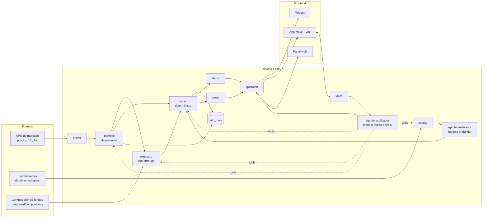
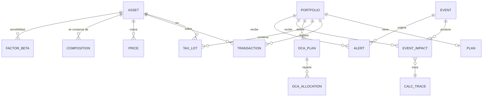
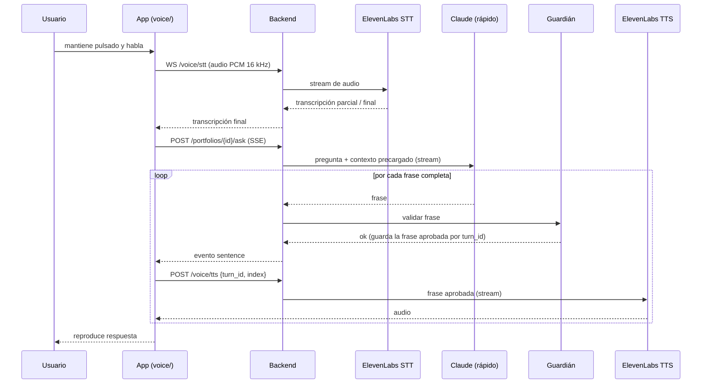

# SPEC — KAIROS

Especificación técnica viva. Si el código y este documento discrepan, se arregla uno de los dos en el mismo PR.

Última revisión: 2026-11-08 · Responsable del documento: todo el equipo (lo actualiza quien cambie algo de lo que describe)

---

## 1. Visión técnica en 5 líneas

- Monorepo con backend Python (FastAPI) y frontend React + TypeScript (web móvil + panel web), PostgreSQL y Docker Compose.
- Dos motores **deterministas** (gestor de cartera y motor de impacto) calculan todas las cifras.
- Tres agentes con Claude: **analizador de eventos** (modelo profundo, por adelantado), **explicador** (modelo rápido, con herramientas) y **guardián** (reglas deterministas + opcional LLM).
- Voz con ElevenLabs: voz a texto en tiempo real y texto a voz en streaming.
- Los eventos se reproducen en **modo replay**: la demo no depende de que pase algo en el mundo.

## 2. Stack

| Capa | Tecnología | Versión / nota |
| --- | --- | --- |
| Backend | Python 3.12, FastAPI, Uvicorn | Gestor `uv` |
| ORM / migraciones | SQLAlchemy 2.0 + Alembic | Modelos tipados (`Mapped[...]`) |
| Validación / contratos | Pydantic v2 | `backend/app/schemas/` |
| Base de datos | PostgreSQL 16 | Volumen Docker; `make seed` la llena |
| Cálculo | numpy (D-050) | Solo en `impact/` y `scripts/` |
| LLM | API de Anthropic (SDK `anthropic`) | IDs de modelo por variable de entorno (§9) |
| Voz | ElevenLabs: Scribe v2 Realtime (STT) + Flash v2.5 (TTS) | IDs exactos a verificar en la doc de ElevenLabs (tarea T0-09) |
| Frontend | React 19 + TypeScript + Vite | `openapi-typescript` para tipos; TanStack Query para datos |
| Estilos | Tailwind CSS 4 | Contraste AA, tipografía base 18 px en la app móvil |
| Gráficos (panel) | Recharts | Solo en el panel, nunca en la portada móvil |
| Tests | pytest, pytest-asyncio, vitest, Playwright (smoke de la demo) | |
| Lint | ruff, mypy, eslint, tsc | `make lint` |
| Despliegue | Docker Compose | `docker compose up` debe bastar para el jurado |

## 3. Estructura del repositorio

```
kairos/
├── CLAUDE.md
├── README.md                    # lo que lee el jurado
├── .env.example
├── docker-compose.yml
├── Makefile
├── .claude/commands/            # /inicio, /cierre, /decision, /coger
├── docs/
│   ├── INGENIERIA.md
│   ├── SPEC.md
│   ├── decisiones.md            # cabecera e índice generado
│   ├── decisiones/              # una decisión por fichero: D-NNN-slug.md
│   └── TABLERO.md
├── backend/
│   ├── pyproject.toml
│   ├── alembic/
│   ├── app/
│   │   ├── main.py              # crea la app y monta routers
│   │   ├── config.py            # Settings (pydantic-settings) desde .env
│   │   ├── core/                # clock.py, db.py, errors.py, trace.py (compartido)
│   │   ├── schemas/             # CONTRATOS compartidos (Pydantic)
│   │   ├── portfolio/           # posiciones, lotes, operaciones, DCA, valoración
│   │   ├── prices/              # precios, VL, tipos de cambio, caché
│   │   ├── exposure/            # look-through, radar de riesgos/oportunidades
│   │   ├── impact/              # betas, impacto por evento, escenarios, `explain_move`
│   │   ├── status/              # estado y frase del widget
│   │   ├── events/              # ingesta, replay, almacenamiento de eventos
│   │   ├── agents/              # analyzer.py, explainer.py, guardian.py, tools.py, prompts/
│   │   ├── alerts/              # avisos, umbral y límite semanal
│   │   ├── planning/            # proyección con DCA ("¿voy bien?") y agenda de eventos
│   │   ├── voice/               # STT/TTS ElevenLabs
│   │   └── api/                 # routers HTTP, uno por módulo
│   └── tests/
│       ├── golden/              # carteras Laura y Javier con resultados esperados
│       └── fakes/               # FakeClaude, FakeElevenLabs, FakePriceProvider
├── frontend/
│   └── src/
│       ├── api/                 # cliente + generated/ (tipos) + mocks/
│       ├── widget/              # pantalla de inicio simulada con el widget
│       ├── app/                 # app móvil: Inicio · Cartera · Pregunta
│       ├── panel/               # panel web de contexto
│       ├── voice/               # push-to-talk, captura y reproducción de audio
│       └── components/
├── data/
│   ├── seed/
│   │   ├── assets.json          # catálogo de activos (ISIN, tipo, divisa, TER, traspasable)
│   │   ├── compositions/        # <ISIN>.csv · composición para look-through
│   │   └── portfolios/          # laura.json, javier.json (+ plan y DCA)
│   ├── prices/                  # <ISIN|TICKER>.csv · histórico diario 2-3 años
│   ├── factors/                 # series de los factores (índices, bund, brent, eurusd)
│   └── events/replay/           # <event_id>.json · eventos reales preparados
└── scripts/                     # seed_db.py, compute_betas.py, replay_event.py, fetch_prices.py
```

Cada módulo de backend sigue el mismo patrón:

```
<modulo>/
├── service.py      # API pública del módulo (lo único que importan otros módulos)
├── engine.py       # lógica pura, sin BD ni red (solo motores)
├── repository.py   # acceso a BD
├── models.py       # tablas SQLAlchemy del módulo
└── mock.py         # implementación falsa de service.py para desbloquear a otros
```

## 4. Arquitectura



Flujo de un evento: `events` carga el JSON del replay → `analyzer` (modelo profundo) produce un `EventAnalysis` estructurado (tipo, entidades, canales o factores afectados, cadena causal; sin cifras) → `events` construye el `ShockSet` con las magnitudes observadas (`observed`) de los canales elegidos → `impact` calcula el impacto en € para cada cartera → `status` y `alerts` deciden estado del widget y si se envía aviso → las frases pasan por el `guardian` → frontend.

Flujo de una pregunta por voz: audio → `voice` (STT) → texto → `explainer` con contexto precargado y herramientas → texto en streaming → `guardian` frase a frase → `voice` (TTS) → audio.

## 5. Contratos (`backend/app/schemas/`)

Los esquemas son la frontera entre tareas y entre backend y frontend. **Los contratos completos (convenciones, enums, ejemplos JSON y reglas) están en `docs/superpowers/specs/2026-11-08-kairos-mvp-design.md` §3 y §4**; este documento no los duplica. El frontend genera sus tipos con `make gen-api`.

| Fichero de esquemas | Contenido | Sección del diseño |
| --- | --- | --- |
| `common.py` | `Money`, `SourceRef`, enums compartidos, `ErrorOut` (códigos de `core/errors.py`) | §3 |
| `portfolio.py` | `PortfolioOut`, `PlanOut`, operaciones, traspaso, DCA, `ValueChangeOut`, `TraceOut`, `AssetOut` | §4.1 |
| `prices.py` | `PriceOut` (lo devuelven `prices.latest()` y `history()`; sin endpoint) y `TickerOut` / `TickerItemOut` (ticker de Inicio, T2-17) | §4.1 |
| `demo.py` | `DemoResetRequest`, `DemoResetOut` (`ReplayOut` está en `events.py`) | §4.6 |
| `events.py` · `agents.py` · `alerts.py` | `EventAnalysis`, `ShockSet`, `AskRequest` + SSE, `ExplainerContext`, `GuardianRequest/Verdict`, `AlertOut` | §4.2, §4.4 |
| `impact.py` · `exposure.py` · `radar.py` · `status.py` · `planning.py` | `EventImpactOut`, `ScenarioOut`, `MoveAttributionOut`, `ExposureOut`, `RadarOut`, `StatusOut`, `ProjectionOut`, `AgendaItemOut` | §4.3 |
| `voice.py` | WebSocket de STT, TTS, disclaimer | §4.5 |

Cada esquema tiene un ejemplo en `schemas/examples/<Modelo>.json` (con `"illustrative": true`), validado por un test en CI. Esos ejemplos son los mocks del backend y del frontend (D-018).

Regla: los contratos se cierran en la fase 0. Después, un cambio de contrato es un PR propio (sin mezclar implementación), con una fila en *Peticiones de contrato* del tablero y aviso al equipo. Añadir un campo opcional es aceptable; renombrar o quitar, no.

## 6. Modelo de datos



| Tabla | Columnas clave | Notas |
| --- | --- | --- |
| `portfolio` | id, name, profile (`conservador`/`moderado`/`dinamico`), base_currency=EUR, created_at | Sin login: la demo elige Laura o Javier |
| `plan` | portfolio_id, target_equity_pct, target_fixed_income_pct, target_cash_pct, drift_threshold (fracción, def. 0,10), goal_amount_eur, goal_year | |
| `asset` | id, isin, ticker, name, asset_type, asset_class, currency, ter, transferable, price_kind, price_source | `transferable` = fondo de inversión (traspaso sin tributar) |
| `price` | asset_id, ts, value, currency, source | PK (asset_id, ts) |
| `fx_rate` | pair (`EURUSD`…), ts, rate, source | |
| `transaction` | id, portfolio_id, type, asset_id, ts, units, price, price_currency, fx_rate, amount_eur, realized_gain_eur, linked_tx_id, dca_plan_id, calc_id | type: `buy`, `sell`, `transfer_out`, `transfer_in`, `dca_buy`, `initial` |
| `tax_lot` | id, portfolio_id, asset_id, acquired_at, units_initial, units_remaining, cost_eur_per_unit, origin_tx_id | Base de FIFO y traspasos |
| `dca_plan` / `dca_allocation` | amount_eur, frequency, day, status, last_execution_at, next_execution_at / asset_id, weight | Σ weight = 1 |
| `dca_execution` / `dca_execution_line` | dca_plan_id, scheduled_for, status (`pending`/`confirmed`/`skipped`), created_at, resolved_at / asset_id, amount_eur, price, price_at, units_estimated, transaction_id | Una ejecución por fecha; al confirmar, cada línea apunta a su `transaction` (D-042) |
| `demo_adjustment` | portfolio_id, event_id, asset_id, impact_eur, label, calc_id, created_at | Solo con `DEMO_MODE=true`; una fila por posición; la borra `/demo/reset` (D-031, D-042) |
| `composition` | fund_asset_id, constituent_key, name, weight, country, sector, currency, as_of, source | Pesos normalizados; "Otros" para el resto |
| `factor_beta` | asset_id, factor, beta, std_err, r2, n_obs, window_start, window_end | Calculado por `make betas` y, al arrancar, por el servicio `seed` (`make up` y `make seed`) |
| `event` | id, type, title, text, occurred_at, replay, source_urls, entities (json), analysis (json `EventAnalysis`), analyzed_model, created_at | |
| `event_impact` | event_id, portfolio_id, impact_eur, low_eur, high_eur, impact_pct, confidence, polarity, breakdown (json), explanation, explanation_status, calc_id, created_at | |
| `alert` | id, portfolio_id, event_id, kind, score, message, created_at, delivered, calc_id | `calc_id` solo en los avisos sin evento (`market_move`); los de evento toman el del impacto (D-076) |
| `calc_trace` | id, kind, formula, inputs (json), outputs (json), sources (json), parent_calc_ids (json), created_at | Trazabilidad de cada cifra. Modelo en `core/trace.py` (D-034) |
| `agent_log` | id, agent, model, prompt_hash, tool_calls (json), output, guardian_verdict (json), latency_ms, created_at | Para depurar y para la métrica de latencia |

**Implementación** (T1-01, D-042): cada módulo declara sus tablas en `models.py` y `app/models.py` las registra todas. Migraciones con Alembic en `backend/alembic/` (`alembic upgrade head`; la ejecuta el servicio `seed`). Euros `NUMERIC(18,2)`; participaciones, precios y estadísticos `NUMERIC(20,8)`; pesos `NUMERIC(10,8)`; enums como texto.

**Posiciones**: no hay tabla `position`. Se derivan de `tax_lot` (suma de `units_remaining` por activo; precio medio = coste total / unidades). El libro de operaciones (`transaction`) es la fuente de verdad; los lotes se pueden reconstruir desde él.

## 7. Gestor de cartera

| Operación | Efecto en lotes | Validaciones |
| --- | --- | --- |
| `initial` (alta) | 1 lote por activo con precio medio y fecha indicada (por defecto, hoy) | ISIN/ticker existe en `asset` |
| `buy` / `dca_buy` | Nuevo lote; por importe → `units = importe / precio` | importe > 0; precio del momento (`prices.latest`) |
| `sell` | Consume lotes por **FIFO**; devuelve plusvalía estimada = Σ (precio − coste) × unidades consumidas | units ≤ unidades disponibles |
| `transfer` | `transfer_out` del fondo origen (FIFO) + `transfer_in` al destino. Los lotes nuevos **conservan `acquired_at` y el coste total** de los lotes consumidos; las unidades se recalculan con el VL de destino | Origen y destino `asset_type == fund`. Si no: error `TRANSFER_NOT_ALLOWED` con mensaje para ofrecer venta + compra con aviso fiscal |

Valoración: `value_eur = units × price × fx(price_currency→EUR)`, con el último precio disponible; se expone `price_at` y `price_kind` para que la app muestre "VL a fecha X". Objetivo < 300 ms tras una operación. Cada `value_eur` se redondea a céntimos y `total_eur` es su suma; pesos y asignación a 4 decimales; el cambio semanal compara con las mismas participaciones a precios de hace 7 días (decisión «Valoración, alta y seed (T1-03)»).

Compra y venta (T1-04, decisión «Compra y venta FIFO (T1-04)»): `unit_eur = price × fx` a 8 decimales es el coste del lote comprado. Por participaciones, `amount_eur = units × price × fx` a céntimos; por importe, `units = amount_eur / unit_eur` a 8 decimales y se respeta el importe pedido. Plusvalía = `amount_eur − Σ units consumidas × coste del lote` (a céntimos, puede ser negativa). Vender más de lo que hay → 422 `INSUFFICIENT_UNITS`. Cada operación deja una traza `transaction`. Código: `lots.py` (puro), `operations.py` (orquesta), `ledger.py` (tablas `transaction` y `tax_lot`), `quotes.py` (precio y fx) y `errors.py`; `service.py` solo delega.

DCA (T1-06, decisión «DCA real (T1-06)»): `day` es el día del mes (1-28) o el día ISO de la semana (1-7); las fechas son el inicio del día en UTC. Al crear o editar el día, `next_execution_at` es la primera fecha desde hoy (hoy cuenta). El job (`service.run_dca_due`) crea una ejecución pendiente por cada plan activo cuya `next_execution_at` ha llegado; en demo, `POST /demo/dca/run` la crea para hoy en todos los planes activos. Como mucho una pendiente por plan y una ejecución por fecha. Cada línea es `amount_eur × weight` a céntimos (el resto del redondeo va a la primera línea, la de más peso) con las participaciones estimadas al precio del momento. Confirmar compra cada línea (`dca_buy`, con `dca_plan_id`) al precio del momento de confirmar, abre un lote por línea, deja una traza `dca` y actualiza las líneas con lo ejecutado; saltar no mueve dinero. Al resolver, `next_execution_at` pasa a la siguiente fecha del plan posterior a `scheduled_for` y, si se confirma, `last_execution_at = scheduled_for`. Código: `dca.py` (puro), `dca_flow.py` (orquesta), `dca_store.py` (tablas de DCA).

Traspaso (T1-05, decisión «Traspaso fondo → fondo (T1-05)»): el origen se dimensiona y consume como una venta (`size_trade` y FIFO), sin plusvalía. Cada lote consumido abre un lote en el destino con la misma `acquired_at`, `units = units consumidas × unit_eur origen / unit_eur destino` y `coste = coste total consumido / units` (8 decimales, HALF_EVEN), así que el coste total se conserva con un error inferior a 0,000001 €. En el libro quedan un `transfer_out` y un `transfer_in` por el mismo `amount_eur` (el de entrada tiene en `linked_tx_id` el de salida) y una traza `transfer`; la variación de valor los ve como flujo neto cero. Si alguno de los dos no es fondo, 422 `TRANSFER_NOT_ALLOWED` con `from_asset_type`, `to_asset_type`, `alternative: "sell_and_buy"` y `estimated_gain_eur` (la plusvalía FIFO de vender esas participaciones, con su `calc_id`; `null` si no hay bastantes o no hay precio). Origen y destino iguales → 422 `VALIDATION_ERROR`. Código: `transfers.py`.

Plan y variación de valor (T1-07, D-057): `current` es el peso de cada clase a 4 decimales, y `mixed` cuenta mitad renta variable y mitad renta fija. `drift_equity = current.equity − target.equity`; `drift_exceeded = |drift_equity| > drift_threshold`. `PUT /plan` exige un objetivo que sume exactamente 1 y un umbral en (0, 1], y conserva los campos opcionales que no se envían. `get_value_change(start, end)` reconstruye las participaciones desde el libro (`ts ≤ t`). Los flujos son las operaciones en `(start, end]`, con signo (entran compras, DCA, altas y traspasos de entrada; salen ventas y traspasos de salida). Se valora con el último cierre no posterior a `t` y el fx en `t`, y deja una traza `move`. Código: `plan.py` y `value_change.py` (puros), `plan_flow.py`, `plan_store.py`.

Evolución del valor (T2-18): `history.get_history(id, period)` aplica las mismas reglas a una serie de días. Días hábiles desde el mismo día de hace 1 semana o 1, 6 o 12 meses (con `max`, uno por semana desde la primera operación) hasta el último día con algún cierre de mercado. Solo se dibujan los días con algún cierre de mercado; los activos de valor fijo no cuentan. Si falta el precio de algún activo, el día se omite: nunca se rellena. `net_flows_eur` son las operaciones entre el primer y el último punto. Sin ajustes de demo (D-031). Deja una traza `valuation`. La ruta llama a `history.py` directamente: `service.py` ya pasa de 300 líneas.

## 8. Motor de impacto y exposición

### 8.1 Factores

| Código | Serie de referencia | Shock en un evento |
| --- | --- | --- |
| `EQ_GLOBAL` | MSCI World en EUR (`IWDA.AS`) | variación % |
| `EQ_US_TECH` | Nasdaq-100 (`^NDX`) | variación % |
| `RATES_EUR` | Rentabilidad a 10 años de la curva AAA del área euro (BCE) | variación absoluta de la rentabilidad, como fracción (`-0.0010` = −10 pb) |
| `OIL` | Brent (`BZ=F`) | variación % |
| `EURUSD` | Tipo de cambio EUR/USD (`EURUSD=X`) | variación % |

Betas: regresión OLS multivariante (los cinco factores a la vez, con término independiente) de rentabilidades diarias del activo (`adj_close`, en su divisa local) sobre los factores, ventana de 3 años; fechas cruzadas antes de calcular rentabilidades (`scripts/compute_betas.py` → `impact/betas.py`, numpy; D-050). Se guardan beta, error estándar, R² del modelo y nº de observaciones. Los activos de precio fijo no tienen betas. Las betas de `RATES_EUR` se estiman en la misma unidad que el shock (fracción).

### 8.2 Impacto de un evento sobre una posición *i* (valor `V_i` en €)

Las magnitudes de los shocks `s_f` y de los movimientos `m_c` salen del campo `observed` del evento (D-025); el analizador solo elige qué canales aplican.

- **Efecto mercado**: `r_i = Σ_f β_{i,f} · s_f`
- **Efecto divisa** (activos no EUR, `s_EURUSD` = variación de EUR/USD): `r_fx = 1/(1 + s_EURUSD) − 1` sobre la parte de la posición en USD. El USD se separa para enseñar "cuánto es bolsa y cuánto es dólar": `fx_eur = impact_eur − market_eur`, que incluye también `β_{i,EURUSD} · s_EURUSD` y el término cruzado (D-051).
- **Resultados de una empresa *c***: `r_i = w_{i,c} · m_c` con `w_{i,c}` el peso de la empresa dentro del fondo (look-through; 1 si es acción directa) y `m_c` el movimiento de la acción. El activo **no** recibe además el shock de factor por esa misma empresa (sin doble conteo). En eventos `earnings`, los factores seleccionados se aplican al resto del activo con peso `(1 − w_{i,c})`.
- **Impacto**: `I_i = V_i · ((1 + r_i)(1 + r_fx) − 1)`; cartera: `I = Σ I_i`.
- **Rango** (80%): `I ± 1,28 · sqrt(Σ_i (V_i · (1 − Σ_c w_{i,c}) · Σ_f u_{i,f})²)` con `u_{i,f} = se_{i,f} · |s_f|` y, si la beta no es significativa (`|β/se| < 2`), además `|β_{i,f} · s_f|`; esa beta no suma a `I` (D-050, D-051). Aproximación que trata los errores de cada activo como independientes; está documentada en la traza.
- **Confianza**: `alta` si R² medio ponderado ≥ 0,6 y cobertura de look-through ≥ 90%; `media` si R² ≥ 0,3; `baja` en otro caso.
- **Polaridad**: `riesgo` si `high_eur < 0`. `oportunidad` si `low_eur > 0` **y** más del 50 % del impacto positivo cae en una clase de activo que está por debajo de su objetivo en el plan del usuario (el evento acerca la cartera al plan). `neutral` en el resto.

Todo devuelve `calc_id` con entradas (betas, shocks, valores), salidas y fuentes.

### 8.3 Escenarios ¿Y si…? (F25)

Mismo cálculo con shocks fijados por el usuario (`{"EQ_GLOBAL": -0.10}`). Objetivo < 500 ms.

**«¿Por qué ha bajado?» (`explain_move`, T2-07).** Ventana `[now − periodo, now]` (`day` = 1 día, `week` = 7, `month` = 30). Por activo: `Δ_i = V_i(end) − V_i(start) − flows_i + adj_i`, con `get_value_change` (precios reales) y el ajuste de demo de los eventos de la ventana, solo en activos que siguen en cartera. `change_pct = change / Σ V_i(start)` a 4 decimales (0 sin valor inicial). `by_asset` omite los activos sin cambio y va de mayor a menor |Δ|. `by_event` = impactos calculados en la ventana; `unexplained = change − Σ impact_eur`. Traza `move` con `parent_calc_ids` = `get_value_change` + impactos. Código: `move.py` (puro) y `move_flow.py`.

### 8.4 Exposición (look-through)

`exposición_x = Σ_i V_i · Σ_c w_{i,c} · [c pertenece a x]` para país, sector, divisa y empresa. Acciones directas cuentan como un fondo de un solo componente. Solapamiento: empresas presentes en ≥ 2 posiciones, con la suma de su peso en la cartera. Las claves `OTROS_`, `GOV_` y `BONOS_` cuentan en país, sector y divisa, pero no son empresas. `coverage_pct` es la parte del patrimonio con país conocido; un depósito o un plan sin composición no la tiene (D-052).

### 8.5 Radar (F24)

| Señal | Regla |
| --- | --- |
| Concentración | Una empresa > 5% de la cartera o top-10 empresas > 25% |
| Divisa | Exposición no EUR > 50% |
| Desviación del plan | `|equity_pct − target_equity_pct| > drift_threshold` (fracción, def. 0,10) |
| Reequilibrio con aportaciones | Si hay desviación y DCA activo: cuántos meses de DCA dirigidos al activo infraponderado lo corrigen |
| Aportación más barata | Activo del DCA ha caído > 3% desde la última aportación |
| Traspaso sin tributar | Solo con desviación del plan: fondo con `transferable = true` y plusvalía latente > 0 en la clase sobreponderada, y fondo traspasable en la infraponderada. `user_rule` = el plan (D-078) |

La divisa no cuenta EUR ni la desconocida (`OTHER`). La concentración da un solo aviso aunque salten las dos condiciones. Reglas en `exposure/radar.py`; textos en `exposure/templates.py`.

### 8.6 Estado del widget (`status/`)

Precedencia: `atento` > `revisa_plan` > `tranquilo`.

- `atento`: existe un `event_impact` de las últimas 72 h con `|impact_eur| ≥ max(150 €, 0,5% del patrimonio)`.
- `revisa_plan`: `|equity − target_equity| > drift_threshold` (fracción; por defecto 0,10, D-022).
- `tranquilo`: en otro caso.

La ventana de 72 h se mide con la fecha del evento (`occurred_at`), no con la del cálculo.

La frase se precalcula al cambiar el estado (plantilla + modelo rápido, validada por el guardián) para responder en < 1 s. El estado se guarda en memoria por cartera: `recompute`, tras cada evento, redacta con el modelo; `GET /status` nunca llama al modelo y cada 10 s comprueba si han cambiado los datos (si es así, usa la plantilla validada). El `calc_id` solo cambia si cambian los datos.

## 9. Agentes

| Agente | Modelo (env) | Cuándo corre | Entrada | Salida |
| --- | --- | --- | --- | --- |
| Analizador | `ANTHROPIC_MODEL_DEEP` (def. `claude-sonnet-5-5`) | Al llegar un evento (replay), una vez por evento | Título, texto, fuentes, consenso si existe | `EventAnalysis` (JSON validado con Pydantic): tipo, entidades, canales (factores), empresas, cadena causal, relevancia. **Sin cifras**; las magnitudes vienen de `observed` |
| Explicador | `ANTHROPIC_MODEL_FAST` (def. `claude-haiku-5-5`) | Pregunta del usuario; frases de widget y avisos | Pregunta + contexto precargado de la cartera (caché de prompt) | Texto en español, 2-3 frases, ≥ 1 cifra en € tomada de herramientas |
| Guardián | Reglas deterministas (+ modelo rápido opcional) | Sobre toda salida antes del usuario | Texto + resultados de herramientas del turno | `ok` / `blocked(motivo)` |

**Herramientas del explicador** (`agents/tools.py`, cada una llama al `service.py` del módulo dueño):

| Herramienta | Módulo | Devuelve |
| --- | --- | --- |
| `get_portfolio` | portfolio | `PortfolioOut` |
| `get_exposure` | exposure | `ExposureOut` |
| `get_events(days)` | events + impact | `list[EventImpactOut]` |
| `estimate_impact(shocks)` | impact | escenario con rango |
| `check_plan` | portfolio + planning | desviación, proyección DCA frente al objetivo |
| `explain_move(period)` | impact | atribución del cambio de valor a activos y eventos |

**Latencia de voz**: el contexto básico (patrimonio, asignación, eventos de 7 días con su impacto, estado del plan) va precargado en el prompt con caché, para que las 3 preguntas típicas se respondan sin llamadas a herramientas. Las herramientas quedan para preguntas específicas.

**Guardián** (`agents/guardian.py`):

1. **Patrones prohibidos** (regex, sin acentos y en minúsculas): imperativos y recomendaciones de compraventa (`compra`, `vende`, `vendas`, `compres`, `te recomiendo`, `deberias (comprar|vender|invertir)`, `es buen momento para`, `invierte en`, `sal de`…). Lista en `prompts/forbidden.yaml`, con tests: cada patrón lleva frases que debe bloquear (`blocks`) y frases del dominio que no (`allows`). "Compra", "vende" e "invierte" solo se bloquean como imperativo (inicio de cláusula o pronombre pegado), para no bloquear "tu plan compra cada mes".
2. **Cifras** (`agents/guardian_figures.py`): cada número del texto (€, otras monedas, %, puntos, puntos básicos, sin unidad; también pegado a la unidad o con multiplicador: "600EUR", "5M€", "470k") debe coincidir en valor absoluto con algún valor de los resultados de herramientas o del contexto del turno. Tolerancias, siempre al menos el redondeo de lo escrito: el mayor de ±1 € y ±0,5 € de cada 100 €; en % y pp, el menor de ±0,5 pp y el 10 % de la evidencia (con un recorte de 0,25 pp, "0,7 %" se bloquea); en pb, el menor de ±0,5 pb y el 10 %; sin unidad, solo el redondeo. Las monedas extranjeras solo casan con evidencias de su moneda y no cuentan como cifra en €. Cifra no encontrada → bloqueo. Años fuera de las evidencias y números en palabras mayores que diez → bloqueo. No son cifras los enteros sin unidad de 0 a 10, días del mes, horas, ordinales y los nombres de la lista blanca ("S&P 500", "G20", "T3", y códigos como "H100" sin unidad detrás).
3. **Forma**: ≤ 3 frases en voz (contando las ya emitidas, `sentence_index`), ≥ 1 cifra en € en la primera frase si la pregunta es sobre impacto.
4. Bloqueo → un reintento con el motivo como feedback → si falla, respuesta de plantilla construida con los datos de las herramientas. Antes del guardián, el explicador calla sin contarlo como bloqueo (`Emitter.skip_reason`) la frase que repite una ya dicha (parecida en orden o con casi todas sus palabras en la otra) y el relleno sobre la propia respuesta («ya te he dado…», «completo con…»), que aparecen al continuar tras un reintento (T3-10).
5. En streaming se valida **frase a frase** antes de mandarla al TTS.

**Piezas del explicador** (detalle en la decisión del explicador, T1-17):

- `context.py`: `ExplainerContext` por cartera desde los `service.py` (cartera, plan, proyección, eventos de 7 días, estado), cacheado en memoria; `agents.service.invalidate_context` lo invalida.
- `facts.py` y `fact_format.py`: contratos → `facts` con `display` en español ("42.380 euros", "61 %") y evidencias del guardián (incluidos los números del título y el consenso de cada evento).
- `tools.py`: las 6 herramientas; un error del módulo vuelve como `tool_result` de error.
- `explainer.py`, `explainer_prompt.py`, `emitter.py` y `sentences.py`: turno de `/ask` en streaming (plazo de 6 s para el modelo), frase a frase por el guardián; las frases aprobadas se registran en `voice.service.register_approved` para el TTS. El stream siempre acaba en `done` o `error`.
- `templates.py`: respuestas de plantilla por tema (movimiento, evento, plan) y textos de widget, avisos y explicación de evento; `writer.py` redacta estos últimos con su prompt (`prompts/writer.md`), una tarea y un límite de longitud por canal, y el mismo esquema (modelo → guardián → reintento → plantilla).

Prompts en `agents/prompts/*.md`, versionados. Ningún prompt lleva cifras de ejemplo.

## 10. Voz

La voz se parte en **tres tramos independientes**, para que nadie dependa del código de otro para probar. El detalle de los contratos está en el diseño §2 y §4.5.



- **STT**: `WS /voice/stt` devuelve la transcripción final.
- **Respuesta**: `POST /ask` (SSE) emite solo frases ya validadas por el guardián.
- **TTS**: `POST /voice/tts` recibe `turn_id` e `index` y **solo sintetiza frases aprobadas**, buscadas en una caché en memoria por turno (TTL 5 min), nunca texto libre del cliente; si no está aprobada, 404 `SENTENCE_NOT_APPROVED`. Así la regla 3 también cubre el audio.
- **Cifras a palabras**: `voice/numbers.py` (`spell_out`) convierte importes, porcentajes, puntos, fechas y horas a palabras justo antes del TTS. Así el guardián valida dígitos y el audio lee palabras; el texto en pantalla conserva los dígitos (D-043).
- Sin clave de ElevenLabs en `.env`, `voice/` usa el mock (tests y CI, sin red). Con clave, si ElevenLabs falla: `POST /voice/tts` → 503 `UPSTREAM_UNAVAILABLE` y el STT manda `error` `UPSTREAM_UNAVAILABLE`. Al arrancar, el backend calienta la voz en segundo plano (la primera llamada puede tardar 7–11 s).
- Las claves de ElevenLabs y Anthropic no salen del backend.
- El aviso de IA del inicio de la voz es un audio pregenerado (`GET /voice/disclaimer`, `data/voice/disclaimer.mp3`) que suena mientras Claude genera la primera frase: "Soy el asistente de KAIROS, una IA. No es asesoramiento financiero." Solo la primera vez de la sesión.
- Plan B si falla el STT: botón de preguntas sugeridas que manda texto a `/ask` con la misma respuesta hablada. Si falla el TTS, la respuesta se muestra solo en texto.
- **Frontend** (`src/voice/`, pestaña Pregunta): mantener pulsado (ratón, dedo, o Espacio/Intro) → AudioWorklet a PCM 16 kHz → `WS /voice/stt`. Cada frase de `/ask` se muestra al llegar y su audio se pide a `/voice/tts` en paralelo; una cola lo reproduce en orden. Las preguntas sugeridas y el campo de texto están siempre visibles (RF-15). Las llamadas viven en `src/api/ask.ts` y `src/api/voice.ts`.

## 11. API (`/api/v1`)

| Método | Ruta | Para |
| --- | --- | --- |
| GET | `/health` | Comprobación de Docker |
| GET | `/assets/lookup?q=` | Autocompletar por ISIN, ticker o nombre (`list[AssetOut]`) |
| GET | `/portfolios` · `/portfolios/{id}` | Lista (Laura, Javier) y detalle valorado |
| POST | `/portfolios/{id}/positions` | Alta de posiciones |
| POST | `/portfolios/{id}/transactions` | Compra / venta |
| POST | `/portfolios/{id}/transfers` | Traspaso fondo → fondo |
| GET/POST/PATCH | `/portfolios/{id}/dca-plans` | Planes DCA |
| GET | `/portfolios/{id}/dca-executions?status=` | Aportaciones de la cartera (`list[DcaExecutionOut]`); `status=pending` para las que esperan respuesta |
| POST | `/dca-executions/{id}` | Confirmar o saltar aportación |
| GET/PUT | `/portfolios/{id}/plan` | Asignación objetivo y meta |
| GET | `/portfolios/{id}/history?period=1w\|1m\|6m\|1y\|max` | Evolución del valor con precios de cierre (`PortfolioHistoryOut`, T2-18) |
| GET | `/portfolios/{id}/exposure` | Look-through y radiografía |
| GET | `/portfolios/{id}/radar` | Riesgos y oportunidades |
| GET | `/portfolios/{id}/ticker` | Último precio de cada posición y variación frente al cierre anterior, con `calc_id` (ticker de Inicio, T2-17) |
| GET | `/portfolios/{id}/events` | Eventos con su impacto |
| POST | `/portfolios/{id}/scenarios` | ¿Y si…? |
| GET | `/portfolios/{id}/projection` | Proyección con DCA frente al objetivo |
| GET | `/portfolios/{id}/agenda` | Próximos eventos y su exposición |
| GET | `/portfolios/{id}/move?period=` | Atribución de "¿por qué ha bajado?" (`explain_move`) |
| GET | `/portfolios/{id}/status` | Widget |
| POST | `/portfolios/{id}/ask` (SSE) | Pregunta en texto |
| GET | `/portfolios/{id}/alerts` | Avisos |
| WS | `/voice/stt` | Voz a texto |
| POST | `/voice/tts` | Texto a voz, solo frases aprobadas |
| GET | `/voice/disclaimer` | Audio pregenerado del aviso de IA |
| GET | `/traces/{calc_id}` | Pantalla de trazabilidad |
| POST | `/demo/replay/{event_id}` · `/demo/reset` · `/demo/dca/run` · PUT `/demo/clock` | Control de la demo (solo con `DEMO_MODE=true`; si no, 403 `DEMO_MODE_DISABLED`). `/demo/dca/run` devuelve `list[DcaExecutionOut]` |

Errores: `{"code": "TRANSFER_NOT_ALLOWED", "message": "...", "details": {...}}` con HTTP 4xx. Códigos en `core/errors.py`.

## 12. Datos de la demo

| Fichero | Contenido | Estado |
| --- | --- | --- |
| `data/seed/assets.json` | ~10 fondos/ETFs + ~5 acciones + 1 depósito + 1 plan de pensiones | pendiente |
| `data/seed/compositions/*.csv` | Composición de los fondos/ETFs (iShares y factsheets de Vanguard), fecha `as_of`; formato en la decisión «Composición de fondos y ETF (T1-08)» | hecho (T1-08) |
| `data/seed/portfolios/laura.json` | ~40.000 €, RV ~76%, DCA 300 €/mes 70/30 | pendiente |
| `data/seed/portfolios/javier.json` | ~180.000 €, RF ~65%, depósito y plan de pensiones | pendiente |
| `data/prices/<asset_id>.csv` | Histórico diario de 3 años (`date,close,adj_close`) | hecho (T1-09) |
| `data/factors/<FACTOR>.csv` | Series de los factores (`date,value`); `RATES_EUR` como fracción. `EURUSD` (dólares por euro) es también el tipo de cambio de la valoración (`prices`, T1-02) | hecho (T1-09) |
| `data/events/replay/*.json` | 3-4 eventos reales: BCE, petróleo, resultados (+ USD si da tiempo) | pendiente |
| `data/seed/assumptions.json` | Rentabilidad anual por clase de activo para la proyección, con fuente | pendiente |
| `data/events/agenda.json` | Próximos eventos con fechas relativas al reloj de demo (`offset_days`) | hecho (T2-15) |
| `data/voice/disclaimer.mp3` | Aviso de IA pregenerado | pendiente |

Formato de un evento replay (contrato completo en el diseño §4.2):

```json
{
  "id": "bce-2025-06",
  "type": "central_bank",
  "title": "...",
  "occurred_at": "2025-06-05T12:15:00Z",
  "text": "...",
  "source_urls": ["..."],
  "observed": {
    "factors": {"RATES_EUR": "-0.0010", "EQ_GLOBAL": "0.0040"},
    "companies": {}
  },
  "observed_source": "data/prices + data/factors, cierre del día frente al cierre anterior",
  "consensus": {"metric": "rate_change_bp", "expected": "-25", "actual": "-25", "source": "..."},
  "fallback_chain": ["..."],
  "illustrative": false
}
```

`observed` son los movimientos reales de ese día y **son la fuente de las magnitudes** del `ShockSet` (D-025); para resultados de una empresa, `companies` lleva `{"NVDA": "-0.085"}`. `consensus` puede ser `null` (solo el BCE lo lleva, D-021). `fallback_chain` lo escribe una persona y se usa si el analizador falla.

Replay: el evento se reinyecta con `occurred_at = clock.now()` (o el instante indicado) y el impacto se calcula sobre la valoración actual de la cartera. Los precios no se reescriben; con `DEMO_MODE=true` la valoración suma además el impacto estimado como ajuste aparte, con etiqueta y `calc_id` (D-031).

## 13. Configuración (`.env.example`)

```
ANTHROPIC_API_KEY=
ANTHROPIC_MODEL_FAST=claude-haiku-5-5
ANTHROPIC_MODEL_DEEP=claude-sonnet-5-5
ELEVENLABS_API_KEY=
ELEVENLABS_STT_MODEL=        # ID exacto de Scribe v2 Realtime
ELEVENLABS_TTS_MODEL=        # ID exacto de Flash v2.5
ELEVENLABS_VOICE_ID=
MARKET_DATA_PROVIDER=offline # offline | twelvedata | alphavantage | finnhub
MARKET_DATA_API_KEY=
DATABASE_URL=postgresql+psycopg://kairos:kairos@db:5432/kairos
DEMO_MODE=true
DEMO_CLOCK=                  # ISO 8601 opcional para fijar la fecha
```

El umbral de desviación del plan no es una variable de entorno: es el campo `plan.drift_threshold` (fracción, por defecto 0,10; D-022).

Con `MARKET_DATA_PROVIDER=offline` todo funciona con `data/prices`: es el modo por defecto para el jurado.

## 14. Cómo trabaja Claude Code en este repo

1. **Una sesión = una tarea del tablero.** La tarea tiene ID (`T1-04`) y criterio de "hecho". Se coge con `/coger <ID>` (commit de claim) antes de empezar. Si no tiene criterio, se escribe antes de programar.
2. **Plan antes de código** si la tarea toca > 1 fichero: plan corto (ficheros, funciones, tests), confirmación del humano, luego código.
3. **Motores con test primero**: se escribe el caso dorado (entrada → salida esperada calculada a mano o en hoja), luego el código.
4. **Contratos primero, implementación después.** En la fase 0 se publican `schemas` + mocks (domingo 8 a las 23:59) para que nadie espere.
5. **No salir del carril**: los ficheros de tu tarea son tuyos; los de otra tarea en curso, no. Si necesitas cambiar algo suyo, apúntalo en *Bloqueos* o *Peticiones de contrato* y sigue con el mock. Los módulos se llaman entre sí solo vía `service.py`.
6. **Contexto corto**: lee solo lo necesario (CLAUDE.md, tu tarea en el tablero, tu sección de SPEC). Si la conversación crece, `/cierre` → `/clear` → `/inicio`.
7. **Cierre de sesión obligatorio** con `/cierre`: sin notas para retomar, la siguiente sesión empieza a ciegas.
8. **Verificar, no suponer**: comprobar con `make test` y, en frontend, abriendo la pantalla. Nada se marca como hecho sin ejecutar.
