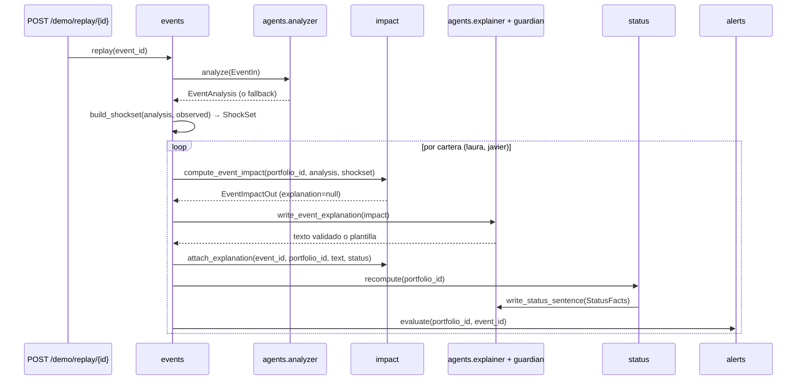

# Diseño técnico del MVP — KAIROS

Fecha: 2026-11-08 · Estado: **aprobado** · Plazo: Dom 8 (tarde) → Mié 11 (entrega antes de las 21:00)

Fuentes, por orden de autoridad:

1. `docs/kairos-spec.md`: producto. **No se cambia.**
2. Este documento: diseño técnico del MVP, **aprobado**.
3. El resto: `CLAUDE.md`, `docs/INGENIERIA.md`, `docs/SPEC.md`, `docs/decisiones.md` y `docs/TABLERO.md`.

Este documento **completa y concreta** esos textos. Si contradice a `SPEC.md`, manda este documento; los documentos vivos ya se han corregido (§9). Si contradice a `kairos-spec.md`, el error está aquí.

**Modelo de trabajo.** No hay roles fijos ni carpetas con dueño. Somos 5 (Manu, Jaime, Marcos, Alons y Javi) y cualquiera puede hacer cualquier tarea. Se trabaja por **fases**, con un pool de tareas en `TABLERO.md`. Quien coge una tarea es dueño, mientras está en curso, de los ficheros que la tarea declara en "Ficheros que toca". La regla completa está en `CLAUDE.md` y la decisión, en `decisiones.md`.

---

## 1. Intención

KAIROS traduce un evento financiero real al impacto en euros sobre una cartera concreta, sin dar órdenes y con cada cifra trazable. El jurado puntúa sobre todo **implementación (30 %)** e **innovación (30 %)**: un producto acabado que se ejecuta con `docker compose up`, no el que tiene más features.

Por eso el diseño optimiza, en este orden:

1. Que el **guion de demo de 8 pasos** funcione entero el **martes 10 a las 18:00** (hito del producto, día 3).
2. Que **5 personas trabajen en paralelo sin esperarse**, gracias a contratos exactos y mocks desde el domingo.
3. Que **ningún número salga del LLM** y todos se puedan rastrear hasta una traza.

### Objetivos

- Las 12 features MVP de `kairos-spec.md`, más lo mínimo de F11 y F13 que exige el guion (§8, decisiones 7 y 8).
- Los objetivos de latencia del producto: widget < 1 s, valoración < 300 ms, primera palabra de voz < 2 s, explicación < 3 s y escenario < 500 ms.

### No objetivos

- Lo marcado como "Si da tiempo" o "Después" en el producto, salvo lo de §8.
- Datos en vivo de noticias, login, widget nativo.

### Antiobjetivos (aunque funcione, sería un fracaso)

- Que una cifra dicha o mostrada no cuadre con su traza.
- Una respuesta con "compra", "vende", "te recomiendo"…
- Que la demo dependa de la red del evento para algo que no sea Claude o ElevenLabs.
- Que alguien edite los ficheros de una tarea en curso de otra persona "para avanzar".

---

## 2. Arquitectura

La arquitectura de componentes de `SPEC.md` §4 se mantiene. Este diseño añade o precisa cinco cosas:

1. **Los números de un evento salen de los datos, no del LLM.** El analizador clasifica el evento, extrae entidades, elige qué canales (factores) aplican y redacta la cadena causal. Las **magnitudes** de los shocks salen del campo `observed` del JSON del replay, que son movimientos reales de ese día. `events` construye un `ShockSet` determinista con los factores que eligió el analizador. Si el analizador falla, se usan todos los factores observados. Así se cumple la regla 1 de `CLAUDE.md` sin perder la parte inteligente.
2. **Pipeline de evento orquestado por `events`.** Cada flecha es una llamada a `service.py`:



   Objetivo: < 10 s de punta a punta por replay (RF-11).
3. **Voz en tres tramos independientes.** Así nadie depende del código de otro para probar:
   - **STT**: `WS /voice/stt` devuelve la transcripción final.
   - **Respuesta**: el frontend llama a `POST /ask` (SSE), que devuelve frases ya validadas por el guardián.
   - **TTS**: por cada frase, el frontend llama a `POST /voice/tts` con `turn_id` e `index`. El backend **solo sintetiza frases aprobadas** por el guardián, que busca en una caché en memoria por `turn_id`, nunca texto libre del cliente. Esto aplica la regla 3 también al audio.
   - El aviso de IA del inicio de la voz es un audio pregenerado (`GET /voice/disclaimer`). Suena mientras Claude genera la primera frase y ayuda a cumplir los < 2 s.
4. **Actualización en el frontend por polling.** `/status` y `/alerts` se consultan cada 5 s. Es más simple que SSE de servidor y basta para la demo. SSE se usa solo en `/ask`.
5. **Dos endpoints nuevos:**
   - `GET /portfolios/{id}/agenda` (módulo `planning`, decisión 15): bloque "Próximos eventos" del panel, F23 MVP.
   - `GET /portfolios/{id}/move?period=week`: atribución de "¿Por qué ha bajado?". Es la herramienta `explain_move`, que antes no tenía endpoint.

Presupuesto de latencia de voz, medido desde que se suelta el botón:

| Tramo | Tiempo |
| --- | --- |
| STT final | ~300 ms |
| Primera frase de Claude rápido (contexto en caché, sin herramientas) | ~700–900 ms |
| Guardián | < 20 ms |
| TTS primer byte | ~300 ms |
| **Total** | **≈ 1,5 s** |

El disclaimer pregenerado cubre la primera vez de la sesión.

---

## 3. Convenciones de todos los contratos

| Tema | Regla |
| --- | --- |
| Importes | `Decimal` serializado como **string**, 2 decimales: `"40123.45"`. Moneda implícita EUR salvo `price_currency` |
| Participaciones y precios | String con hasta 8 decimales: `"152.30451200"` |
| Pesos, porcentajes, variaciones | **Fracción** como string: `"0.76"` = 76 %, `"-0.012"` = −1,2 %. Nunca "puntos porcentuales" en JSON |
| Shock de tipos (`RATES_EUR`) | Variación absoluta de la rentabilidad como fracción: `"-0.0010"` = −10 pb. Las betas de tipos se estiman en la misma unidad |
| Fechas | ISO 8601 en UTC con `Z`. Siempre de `core.clock.now()` |
| IDs | Cartera: `"laura"`, `"javier"`. Activo: ISIN (fondos/ETF) o ticker (acciones). Evento: slug (`"bce-2025-06"`). Traza: `"calc_"` + uuid4 hex |
| Enums | En inglés y minúsculas en el código. Los textos visibles van aparte (`*_label`, en español) |
| Errores | HTTP 4xx/5xx con `{"code": "...", "message": "texto en español", "details": {...}}` |
| Trazabilidad | Toda respuesta con cifras lleva `calc_id`. Las cifras derivadas de varias trazas llevan `parent_calc_ids` en su traza |
| Ejemplos | Cada esquema tiene un JSON en `backend/app/schemas/examples/<Modelo>.json`. Un test valida cada ejemplo contra su modelo Pydantic. Esos ejemplos **son** los mocks del backend (`mock.py` los carga) y del frontend (`make gen-api` los copia a `frontend/src/api/mocks/`). Llevan `"illustrative": true` |

Códigos de error (`core/errors.py`):

- `VALIDATION_ERROR`
- `NOT_FOUND`
- `INSUFFICIENT_UNITS`
- `TRANSFER_NOT_ALLOWED`
- `PRICE_UNAVAILABLE`
- `DCA_ALLOCATION_INVALID`
- `DEMO_MODE_DISABLED`
- `UPSTREAM_UNAVAILABLE` (Claude o ElevenLabs caídos)
- `SENTENCE_NOT_APPROVED` (TTS)

`SourceRef`, común a todos:

```json
{"kind": "price", "label": "VL iShares Core MSCI World", "ref": "IE00B4L5Y983", "as_of": "2026-11-06T00:00:00Z", "url": null}
```

Los valores posibles de `kind` son `price`, `fx`, `composition`, `beta`, `event`, `assumption` y `user_input`.

---

## 4. Contratos

Todas las cifras de los ejemplos son ilustrativas.

### 4.1 Gestor de cartera → motor, agentes y app

**Interfaz Python** (`portfolio/service.py`), lo único que importan otros módulos:

```python
def get_valued(portfolio_id: str) -> PortfolioOut
def get_plan(portfolio_id: str) -> PlanOut
def list_dca_plans(portfolio_id: str) -> list[DcaPlanOut]
def get_value_change(portfolio_id: str, start: datetime, end: datetime) -> ValueChangeOut
def list_portfolio_ids() -> list[str]
# prices/service.py
def latest(asset_id: str) -> PriceOut
def fx_rate(pair: str, at: datetime | None = None) -> Decimal
def history(asset_id: str, start: date, end: date) -> list[PriceOut]
# core/trace.py
def record(kind: str, formula: str, inputs: dict, outputs: dict,
           sources: list[SourceRef], parent_calc_ids: list[str] = []) -> str  # calc_id
```

**`PortfolioOut`**: `GET /portfolios/{id}`.

```json
{
  "id": "laura",
  "name": "Laura",
  "profile": "dinamico",
  "total_eur": "42380.00",
  "change_week_eur": "-514.00",
  "change_week_pct": "-0.012",
  "allocation": {"equity": "0.76", "fixed_income": "0.24", "cash": "0.00", "mixed": "0.00"},
  "positions": [
    {
      "asset_id": "IE00B4L5Y983",
      "isin": "IE00B4L5Y983",
      "ticker": "IWDA",
      "name": "iShares Core MSCI World",
      "asset_type": "etf",
      "asset_class": "equity",
      "units": "152.30451200",
      "avg_cost_eur": "78.10",
      "price": "95.42000000",
      "price_currency": "EUR",
      "price_at": "2026-11-06T16:35:00Z",
      "price_kind": "intraday",
      "fx_rate": "1",
      "value_eur": "14532.85",
      "weight": "0.343",
      "unrealized_pnl_eur": "2637.00",
      "transferable": false,
      "first_acquired_at": "2023-03-05T00:00:00Z"
    }
  ],
  "demo_adjustments": [{"event_id": "nvda-2025-02", "impact_eur": "-470.00", "label": "Estimación tras el evento", "calc_id": "calc_..."}],
  "valued_at": "2026-11-08T18:00:00Z",
  "calc_id": "calc_3f1e..."
}
```

`demo_adjustments` (decisión 17) solo tiene elementos con `DEMO_MODE=true` tras un replay. `total_eur`, `change_week_*` y cada `value_eur` **ya los incluyen**: cada posición suma su `impact_eur` del `breakdown` del evento. La lista va vacía fuera de demo. El frontend muestra la etiqueta junto al patrimonio cuando la lista no está vacía.

Valores de los enums:

- `asset_type`: `fund`, `etf`, `stock`, `deposit`, `pension_plan`.
- `asset_class`: `equity`, `fixed_income`, `cash`, `mixed`.
- `price_kind`: `intraday`, `nav_daily`.
- `profile`: `conservador`, `moderado`, `dinamico`.

**`PlanOut`**: `GET/PUT /portfolios/{id}/plan`.

```json
{
  "portfolio_id": "laura",
  "target": {"equity": "0.70", "fixed_income": "0.30", "cash": "0.00"},
  "drift_threshold": "0.10",
  "goal_amount_eur": "150000.00",
  "goal_year": 2040,
  "current": {"equity": "0.76", "fixed_income": "0.24", "cash": "0.00"},
  "drift_equity": "0.06",
  "drift_exceeded": false,
  "calc_id": "calc_..."
}
```

**Operaciones**: `POST /portfolios/{id}/transactions`.

```json
// request: compra por importe (o "units": "3.5" en vez de amount_eur; exactamente uno de los dos)
{"type": "buy", "asset_id": "IE00B4L5Y983", "amount_eur": "300.00"}
// request: venta
{"type": "sell", "asset_id": "US0378331005", "units": "5"}
```

```json
// response 201
{
  "transaction_id": "tx_...",
  "type": "sell",
  "asset_id": "US0378331005",
  "units": "5.00000000",
  "price": "228.10000000", "price_currency": "USD", "price_at": "2026-11-06T21:00:00Z", "fx_rate": "0.8621",
  "amount_eur": "983.21",
  "effect": {
    "units_after": "10.00000000",
    "avg_cost_eur_after": "151.20",
    "realized_gain_eur": "227.10",
    "lots_consumed": [{"lot_id": "lot_...", "acquired_at": "2023-05-02T00:00:00Z", "units": "5.00000000", "cost_eur_per_unit": "151.20"}]
  },
  "portfolio": { "...": "PortfolioOut" },
  "calc_id": "calc_..."
}
```

**Traspaso**: `POST /portfolios/{id}/transfers`.

```json
// request ("units" o "amount_eur", exactamente uno)
{"from_asset_id": "ES0165151004", "to_asset_id": "IE00BYX5MX67", "units": "120"}
```

```json
// 422 si alguno de los dos no es fund
{"code": "TRANSFER_NOT_ALLOWED",
 "message": "Los ETF y las acciones no admiten traspaso sin tributar. Puedes registrar una venta y una compra; la venta tributa.",
 "details": {"from_asset_type": "etf", "to_asset_type": "fund", "alternative": "sell_and_buy", "estimated_gain_eur": "412.00"}}
```

La respuesta 201 tiene la misma forma que la de una operación. En `effect` va `lots_created` (con `acquired_at` y el coste total conservados) en lugar de `realized_gain_eur`.

**DCA**: `GET/POST/PATCH /portfolios/{id}/dca-plans`, `POST /dca-executions/{id}`.

```json
// DcaPlanOut
{"id": "dca_1", "portfolio_id": "laura", "amount_eur": "300.00", "frequency": "monthly", "day": 5,
 "status": "active", "allocations": [{"asset_id": "IE00B4L5Y983", "weight": "0.70"}, {"asset_id": "IE00BYX5MX67", "weight": "0.30"}],
 "last_execution_at": "2026-10-05T00:00:00Z", "next_execution_at": "2026-11-05T00:00:00Z"}
// DcaExecutionOut (POST /demo/dca/run crea una "pending")
{"id": "dcx_...", "dca_plan_id": "dca_1", "scheduled_for": "2026-11-05T00:00:00Z", "status": "pending",
 "lines": [{"asset_id": "IE00B4L5Y983", "amount_eur": "210.00", "price": "95.42000000", "price_at": "...", "units_estimated": "2.20079648"}]}
// POST /dca-executions/{id}   request: {"action": "confirm"} | {"action": "skip"}
```

Valores permitidos: `frequency` es `monthly` o `weekly`; `status` del plan es `active` o `paused`; `status` de la ejecución es `pending`, `confirmed` o `skipped`. Que Σ weight sea 1 se valida con tolerancia 0, porque es `Decimal`.

**`ValueChangeOut`** (solo interno, para `explain_move`):

```json
{"portfolio_id": "laura", "start": "...", "end": "...", "start_value_eur": "42894.00", "end_value_eur": "42380.00",
 "net_flows_eur": "0.00",
 "by_asset": [{"asset_id": "...", "start_value_eur": "...", "end_value_eur": "...", "flows_eur": "0.00"}],
 "calc_id": "calc_..."}
```

**`TraceOut`**: `GET /traces/{calc_id}` (la pantalla de traza está en el frontend).

```json
{"calc_id": "calc_...", "kind": "event_impact", "created_at": "...",
 "formula": "I_i = V_i · ((1 + Σ_f β_if·s_f)(1 + r_fx) − 1)",
 "inputs": {"positions": ["..."], "betas": ["..."], "shocks": {"RATES_EUR": "-0.0010"}},
 "outputs": {"impact_eur": "90.00", "low_eur": "40.00", "high_eur": "140.00"},
 "sources": [{"kind": "event", "label": "BCE 5 jun 2025", "ref": "bce-2025-06", "as_of": "...", "url": "https://..."}],
 "parent_calc_ids": ["calc_..."]}
```

Valores de `kind`: `valuation`, `transaction`, `transfer`, `dca`, `plan`, `exposure`, `event_impact`, `scenario`, `projection`, `status`, `radar`, `move` y `agenda`.

### 4.2 Analizador → motor de impacto

**Evento de replay** (`data/events/replay/<id>.json`). Amplía el formato de `SPEC.md` §12: `observed` se separa en factores y empresas, y `consensus` pasa a ser un objeto con nombre.

```json
{
  "id": "bce-2025-06",
  "type": "central_bank",
  "title": "El BCE baja los tipos 0,25 puntos",
  "occurred_at": "2025-06-05T12:15:00Z",
  "text": "…comunicado o nota de prensa, en español…",
  "source_urls": ["https://www.ecb.europa.eu/..."],
  "observed": {
    "factors": {"RATES_EUR": "-0.0010", "EQ_GLOBAL": "0.0040", "EQ_US_TECH": "0.0030", "OIL": "0.0010", "EURUSD": "-0.0020"},
    "companies": {}
  },
  "observed_source": "data/prices + data/factors, cierre del día frente al cierre anterior",
  "consensus": {"metric": "rate_change_bp", "expected": "-25", "actual": "-25", "source": "…"},
  "illustrative": false
}
```

Para resultados de una empresa: `"companies": {"NVDA": "-0.085"}`. La clave es la misma `constituent_key` que en `composition`. `consensus` puede ser `null` (decisión 6 de §8).

**`EventAnalysis`**: salida del analizador, validada con Pydantic y guardada en `event.analysis`. **No contiene ningún número**: un validador rechaza dígitos en los campos de texto, salvo `title`, que viene del JSON del evento.

```json
{
  "schema_version": 1,
  "event_id": "bce-2025-06",
  "event_type": "central_bank",
  "entities": [{"kind": "central_bank", "key": "ECB", "name": "Banco Central Europeo"}],
  "channels": [
    {"factor": "RATES_EUR", "direction": "down", "label": "tipos", "rationale": "Bajada de tipos oficiales"},
    {"factor": "EQ_GLOBAL", "direction": "up", "label": "bolsa", "rationale": "Financiación más barata"}
  ],
  "companies": [],
  "causal_chain": ["El BCE baja los tipos", "Baja la rentabilidad de los bonos", "Suben de precio los fondos de renta fija"],
  "relevance": "high",
  "analyzed_model": "claude-sonnet-5-5",
  "fallback": false
}
```

Valores permitidos:

- `event_type`: `central_bank`, `commodity`, `earnings`, `fx`, `macro`.
- `entities[].kind`: `central_bank`, `company`, `commodity`, `currency`, `country`.
- `channels[].factor`: `EQ_GLOBAL`, `EQ_US_TECH`, `RATES_EUR`, `OIL`, `EURUSD`.
- `direction`: `up`, `down`.
- `companies[]`: `{"key": "NVDA", "name": "NVIDIA"}`.
- `relevance`: `high`, `medium`, `low`.

Si el analizador falla tras 1 reintento, `events` crea un análisis de respaldo: `fallback: true`, canales iguales a todas las claves de `observed.factors`, y `causal_chain` tomada de un campo `fallback_chain` del JSON del replay, que escribe un humano.

**`ShockSet`**: lo construye `events` de forma determinista y entra en el motor.

```json
{"event_id": "bce-2025-06",
 "factor_shocks": {"RATES_EUR": "-0.0010", "EQ_GLOBAL": "0.0040"},
 "company_moves": {},
 "selected_by": "analyzer",
 "source": {"kind": "event", "label": "Movimientos observados el 5 jun 2025", "ref": "bce-2025-06", "as_of": "2025-06-05T00:00:00Z", "url": null}}
```

`selected_by` vale `analyzer` o `all_observed`.

**Interfaz Python del motor** (`impact/service.py`):

```python
def compute_event_impact(portfolio_id: str, analysis: EventAnalysis, shocks: ShockSet) -> EventImpactOut
def attach_explanation(event_id: str, portfolio_id: str, text: str, status: ExplanationStatus) -> None
def estimate_scenario(portfolio_id: str, shocks: dict[Factor, Decimal]) -> ScenarioOut
def list_event_impacts(portfolio_id: str, days: int) -> list[EventImpactOut]
def explain_move(portfolio_id: str, period: Literal["day", "week", "month"]) -> MoveAttributionOut
# exposure/service.py
def get_exposure(portfolio_id: str) -> ExposureOut
def get_radar(portfolio_id: str) -> RadarOut
# planning/service.py (decisión 15)
def get_projection(portfolio_id: str) -> ProjectionOut
def get_agenda(portfolio_id: str) -> list[AgendaItemOut]
# status/service.py
def get_status(portfolio_id: str) -> StatusOut          # lee lo precalculado (< 200 ms)
def recompute(portfolio_id: str) -> StatusOut
```

### 4.3 Motor de impacto y exposición → agentes y app

**`EventImpactOut`**: `GET /portfolios/{id}/events?days=7` devuelve una lista.

```json
{
  "event_id": "bce-2025-06",
  "portfolio_id": "laura",
  "title": "El BCE baja los tipos 0,25 puntos",
  "event_type": "central_bank",
  "occurred_at": "2026-11-08T18:02:00Z",
  "causal_chain": ["El BCE baja los tipos", "Baja la rentabilidad de los bonos", "Suben tus fondos de renta fija"],
  "impact_eur": "90.00", "low_eur": "40.00", "high_eur": "140.00",
  "impact_pct": "0.0021",
  "confidence": "media",
  "polarity": "neutral",
  "breakdown": [
    {"asset_id": "IE00BYX5MX67", "name": "Vanguard Global Bond", "value_eur": "10171.00",
     "impact_eur": "61.00", "market_eur": "61.00", "fx_eur": "0.00", "channel": "tipos"}
  ],
  "surprise": {"label": "en_linea", "expected": "-25", "actual": "-25", "metric": "rate_change_bp"},
  "explanation": "Poco. Tus fondos de renta fija suben ligeramente; en total, unos 90 euros a tu favor.",
  "explanation_status": "ok",
  "sources": [{"kind": "event", "...": "..."}],
  "calc_id": "calc_..."
}
```

Notas sobre los campos:

- `confidence`: `alta`, `media`, `baja`.
- `polarity`: `riesgo`, `oportunidad`, `neutral`.
- `explanation_status`: `pending`, `ok`, `template`.
- `surprise.label`: `mejor`, `peor`, `en_linea`. Es `null` si no hay consenso.
- El último eslabón de `causal_chain` lo pone el motor con plantilla: la clase de activo con mayor |impacto| de esa cartera ("Suben tus fondos de renta fija"). Así es personal y sin LLM.

Reglas que concretan `SPEC.md` §8.2:

- **`oportunidad`**: `low_eur > 0` **y** más del 50 % del impacto positivo cae en una clase de activo que está por debajo de su objetivo en el plan, es decir, el evento acerca la cartera al plan del usuario. `riesgo` si `high_eur < 0`. `neutral` en el resto.
- **`channel`**: es el `label` del canal del analizador con mayor contribución en ese activo. Los valores son "tipos", "bolsa", "tecnológicas", "petróleo", "dólar" y "resultados NVDA".
- **Resultados**: `company_moves` se aplica vía look-through (`w_{i,c} · m_c`). El activo **no** recibe además el shock de factor por esa misma empresa, para no contarlo dos veces. En eventos `earnings`, los factores seleccionados se aplican al resto del activo con su peso `(1 − w_{i,c})`.

**`ScenarioOut`**: `POST /portfolios/{id}/scenarios`, F25 (Si da tiempo). El backend se hace igual porque es el mismo cálculo.

```json
// request
{"factor_shocks": {"EQ_GLOBAL": "-0.10"}}
// response
{"factor_shocks": {"EQ_GLOBAL": "-0.10"}, "impact_eur": "-3120.00", "low_eur": "-3600.00", "high_eur": "-2640.00",
 "confidence": "alta", "breakdown": [{"...": "AssetImpact"}], "calc_id": "calc_..."}
```

**`ExposureOut`**: `GET /portfolios/{id}/exposure`.

```json
{
  "by_country":  [{"key": "US", "label": "Estados Unidos", "value_eur": "25850.00", "weight": "0.61"}],
  "by_sector":   [{"key": "information_technology", "label": "Tecnología", "value_eur": "...", "weight": "0.33"}],
  "by_currency": [{"key": "USD", "label": "Dólar", "value_eur": "...", "weight": "0.61"}],
  "top_companies": [{"key": "AAPL", "name": "Apple", "value_eur": "1610.00", "weight": "0.038",
                     "held_in": [{"asset_id": "IE00B4L5Y983", "weight_in_asset": "0.048"}, {"asset_id": "US0378331005", "weight_in_asset": "1"}]}],
  "overlap": [{"key": "AAPL", "name": "Apple", "weight": "0.038", "asset_ids": ["IE00B4L5Y983", "US0378331005"]}],
  "radiography": {
    "num_holdings": 3,
    "top_country": {"key": "US", "label": "Estados Unidos", "weight": "0.61"},
    "top_companies_group": {"n": 7, "weight": "0.19"}
  },
  "coverage_pct": "0.94",
  "as_of": "2026-06-30T00:00:00Z",
  "calc_id": "calc_..."
}
```

`radiography` alimenta el paso 2 del guion (F13 mínima). `num_holdings` cuenta fondos y ETF. `top_companies_group` son las 7 primeras empresas por peso; `N = 7` está fijo en configuración.

**`RadarOut`**: `GET /portfolios/{id}/radar`.

```json
{"items": [
  {"id": "rad_currency", "kind": "risk", "rule": "currency", "title": "El 61 % de tu dinero está en dólares",
   "detail": "Si el dólar cae frente al euro, tu cartera pierde aunque la bolsa no se mueva.",
   "value_eur": "25850.00", "weight": "0.61", "user_rule": null, "calc_id": "calc_..."},
  {"id": "rad_cheaper", "kind": "opportunity", "rule": "cheaper_contribution",
   "title": "Tu aportación de este mes compra más barato", "detail": "...",
   "value_eur": "210.00", "weight": "-0.034", "user_rule": {"source": "dca_plan", "ref": "dca_1"}, "calc_id": "calc_..."}
], "calc_id": "calc_..."}
```

Los valores de `rule` son `concentration`, `currency`, `drift`, `rebalance_with_dca`, `cheaper_contribution` y `tax_free_transfer`. **Invariante (test):** `kind == "opportunity"` ⇒ `user_rule != null`.

Los textos de `title` y `detail` salen de **plantillas deterministas**, sin LLM, con cifras del propio cálculo. No pasan por el guardián porque no son salida de agente. Aun así, un test aplica `forbidden.yaml` a todas las plantillas.

**`StatusOut`**: `GET /portfolios/{id}/status`. Se lee precalculado; objetivo < 200 ms.

```json
{"state": "atento", "state_label": "Atento",
 "total_eur": "42380.00", "change_week_pct": "-0.012",
 "sentence": "Tus fondos tecnológicos caen tras resultados. Toca para ver por qué.",
 "sentence_status": "ok",
 "reason": {"kind": "event", "event_id": "nvda-2025-02", "event_impact_eur": "-514.00"},
 "price_as_of": "2026-11-06T16:35:00Z",
 "computed_at": "2026-11-08T18:02:04Z", "calc_id": "calc_..."}
```

Valores y reglas:

- `state`: `tranquilo`, `atento`, `revisa_plan`.
- `sentence_status`: `ok`, `template`.
- `reason.kind`: `event`, `drift`, `none`.
- La regla para `atento` es la de `SPEC.md` §8.6.
- `revisa_plan` se activa si `|equity − target_equity| > drift_threshold`, con umbral por defecto **0,10** (decisión 7 de §8).

**`ProjectionOut`**: `GET /portfolios/{id}/projection`, F11 mínima para el paso 7.

```json
{"goal_amount_eur": "150000.00", "goal_year": 2040, "current_value_eur": "42380.00",
 "monthly_contribution_eur": "300.00",
 "scenarios": [
   {"name": "pesimista", "annual_return": "0.02", "value_at_goal_eur": "...", "reaches_goal": false},
   {"name": "base", "annual_return": "0.05", "value_at_goal_eur": "...", "reaches_goal": true},
   {"name": "optimista", "annual_return": "0.07", "value_at_goal_eur": "...", "reaches_goal": true}
 ],
 "on_track": true, "gap_eur": "0.00",
 "assumptions_source": {"kind": "assumption", "label": "Supuestos de rentabilidad por clase de activo", "ref": "data/seed/assumptions.json", "as_of": "...", "url": null},
 "calc_id": "calc_..."}
```

Cómo se calcula:

- Capitalización mensual y aportación mensual del DCA activo.
- `annual_return` de cada escenario es la media ponderada por la asignación **objetivo** de los rendimientos por clase de `data/seed/assumptions.json`. Ese fichero lo crea la tarea T0-08, con fuente citada y `"illustrative": true`.
- `on_track` equivale a que el escenario `base` alcanza la meta.

**`AgendaItemOut`**: `GET /portfolios/{id}/agenda`.

```json
[{"date": "2026-11-12T13:15:00Z", "kind": "central_bank", "title": "Reunión del BCE",
  "factor": "RATES_EUR", "exposed_weight": "0.24", "exposed_eur": "10171.00", "calc_id": "calc_..."},
 {"date": "2026-12-05T00:00:00Z", "kind": "dca", "title": "Tu aportación mensual", "factor": null,
  "exposed_weight": null, "exposed_eur": "300.00", "calc_id": "calc_..."}]
```

Cómo se calcula:

- La fuente es `data/events/agenda.json` (tarea T2-15), con fechas **relativas** al reloj de demo (`"offset_days": 4`), más los DCA activos.
- `exposed_eur` = Σ V_i de los activos con |β_{i,f}| ≥ 0,1 en el factor del evento. Para resultados de una empresa, es su exposición por look-through.

**`MoveAttributionOut`**: `GET /portfolios/{id}/move?period=week`, herramienta `explain_move`.

```json
{"period": "week", "start": "...", "end": "...",
 "change_eur": "-514.00", "change_pct": "-0.012",
 "by_asset": [{"asset_id": "...", "name": "...", "change_eur": "-420.00"}],
 "by_event": [{"event_id": "nvda-2025-02", "title": "...", "impact_eur": "-470.00", "low_eur": "...", "high_eur": "..."}],
 "unexplained_eur": "-44.00",
 "calc_id": "calc_..."}
```

`by_asset` sale de `portfolio.get_value_change`, con precios reales, sin flujos y con los ajustes de demo (decisión 17). `by_event` son los `event_impact` del periodo, que son **estimaciones**. `unexplained_eur = change_eur − Σ by_event` y se muestra como "otros movimientos del mercado".

### 4.4 Agentes ↔ app y voz

**`AskRequest`**: `POST /portfolios/{id}/ask`, respuesta `text/event-stream`.

```json
{"question": "¿Por qué ha bajado?", "channel": "voice", "session_id": "ses_..."}
```

`channel` vale `voice` o `text`. `session_id` lo genera el frontend al abrir la app y sirve para saber si toca el aviso de IA.

Eventos SSE, uno por línea `data: {...}`, en este orden:

```json
{"type": "meta", "turn_id": "turn_...", "disclaimer": true}
{"type": "sentence", "turn_id": "turn_...", "index": 0, "text": "Sobre todo por tu fondo tecnológico: las grandes tecnológicas de EE. UU. han caído tras sus resultados.", "calc_ids": []}
{"type": "sentence", "turn_id": "turn_...", "index": 1, "text": "Te ha restado unos 470 euros.", "calc_ids": ["calc_..."]}
{"type": "done", "turn_id": "turn_...", "fallback_used": false, "blocked_count": 0, "first_sentence_ms": 812}
```

`{"type": "error", "turn_id": "...", "code": "UPSTREAM_UNAVAILABLE", "message": "..."}` sustituye a `done` si nada funcionó. Aun así, la plantilla de respaldo se intenta antes de devolver error.

Reglas del flujo:

- `disclaimer: true` → el frontend reproduce `GET /voice/disclaimer` (voz) o muestra el texto del aviso (texto) **antes** de la frase 0.
- Cada `sentence` ya pasó el guardián.
- `calc_ids` son las trazas de las cifras que contiene la frase. Las rellena el guardián al casar cada número.
- Si una frase se bloquea tras el reintento, el resto de la respuesta se sustituye por la plantilla (D-010) y `fallback_used` pasa a `true`.

**Contexto precargado del explicador** (`ExplainerContext`, D-011). Se construye por cartera, se cachea en el prompt y se invalida al cambiar el `calc_id` de `status`:

```json
{"portfolio_id": "laura", "as_of": "...", "persona_hint": "dinamico",
 "facts": [
   {"key": "total", "label": "patrimonio", "value": "42380.00", "unit": "EUR", "display": "42.380 euros", "calc_id": "calc_..."},
   {"key": "change_week", "label": "variación semanal", "value": "-514.00", "unit": "EUR", "display": "514 euros", "calc_id": "calc_..."},
   {"key": "evt.nvda-2025-02.impact", "label": "impacto de resultados de NVIDIA", "value": "-470.00", "unit": "EUR", "display": "470 euros", "calc_id": "calc_..."}
 ],
 "allocation": {"equity": "0.76", "fixed_income": "0.24"},
 "plan": {"on_track": true, "goal_year": 2040, "drift_exceeded": false},
 "events_7d": [{"event_id": "...", "title": "...", "causal_chain": ["..."], "polarity": "riesgo", "confidence": "media", "top_assets": ["..."]}],
 "status": {"state": "atento"}}
```

`facts[].display` es el formato que el prompt pide copiar literalmente. El explicador **solo** puede usar cifras que estén en `facts` o en resultados de herramientas.

**Herramientas del explicador** (`agents/tools.py`). Cada una devuelve el contrato del módulo al que llama, más una lista `facts` con la misma forma que en el contexto:

| Herramienta | Llama a | Devuelve |
| --- | --- | --- |
| `get_portfolio()` | `portfolio.get_valued` | `PortfolioOut` + facts |
| `get_exposure()` | `exposure.get_exposure` | `ExposureOut` + facts |
| `get_events(days)` | `impact.list_event_impacts` | `list[EventImpactOut]` + facts |
| `estimate_impact(factor_shocks)` | `impact.estimate_scenario` | `ScenarioOut` + facts |
| `check_plan()` | `portfolio.get_plan` + `planning.get_projection` | `PlanOut` + `ProjectionOut` + facts |
| `explain_move(period)` | `impact.explain_move` | `MoveAttributionOut` + facts |

**Guardián** (`agents/guardian.py`, función pura y `mypy --strict`):

```json
// GuardianRequest
{"text": "Te ha restado unos 470 euros.", "channel": "voice", "question_kind": "impact", "sentence_index": 1,
 "evidence": [{"value": "-470.00", "unit": "EUR", "calc_id": "calc_..."}, {"value": "0.0025", "unit": "fraction", "calc_id": null, "source": "event:bce-2025-06"}]}
// GuardianVerdict
{"ok": true, "reasons": [], "figures": [{"text": "470 euros", "value": "470", "unit": "EUR", "matched_calc_id": "calc_..."}]}
// bloqueado
{"ok": false, "reasons": [{"code": "UNKNOWN_FIGURE", "detail": "«600 euros» no está en las herramientas"}], "figures": []}
```

Valores de los campos:

- `channel`: `voice`, `text`, `widget`, `alert`, `event_explanation`.
- `question_kind`: `impact`, `general` o `null`.
- `reasons[].code`: `FORBIDDEN_PATTERN`, `UNKNOWN_FIGURE`, `TOO_LONG`, `MISSING_EUR`.

Cómo funciona:

- **Evidencias:** los `facts` del contexto, los de las herramientas usadas en el turno y los números del evento (título, consenso).
- **Cifras:** se comparan **en valor absoluto** con las tolerancias de `SPEC.md` §9, porque el texto dice "te ha restado 470" para −470.
- **Formatos de número que entiende:** `1.295`, `1295`, `0,25`, `61 %`, `61%`, `-4,5 %`, y años de 4 dígitos que estén en las evidencias (`2040`).
- **Números en palabras** ("noventa"): el prompt los prohíbe y el guardián los trata como cifra desconocida si son mayores que diez.
- **Interfaz Python para otros módulos** (`agents/service.py`):
  - `write_event_explanation(impact: EventImpactOut) -> tuple[str, ExplanationStatus]`
  - `write_status_sentence(facts: StatusFacts) -> tuple[str, SentenceStatus]`
  - `write_alert_message(...) -> str`

**`AlertOut`**: `GET /portfolios/{id}/alerts`.

```json
[{"id": "alr_...", "event_id": "nvda-2025-02", "kind": "event_impact", "score": "0.82",
  "message": "Las tecnológicas de EE. UU. caen tras resultados: tu cartera, unos 470 euros menos.",
  "created_at": "...", "delivered": false, "calc_id": "calc_..."}]
```

`kind` vale `event_impact`, `dca_pending` o `drift`. El límite es de **2 avisos por semana ISO** por cartera, según `clock.now()`; los `dca_pending` no cuentan. `score = |impact_eur| / max(150, 0,005 · total)`, y se avisa si `score ≥ 1`.

### 4.5 Voz

**`WS /api/v1/voice/stt`:**

```json
// cliente → servidor
{"type": "start", "sample_rate": 16000, "encoding": "pcm_s16le", "language": "es"}
// … frames binarios PCM …
{"type": "stop"}
// servidor → cliente
{"type": "partial", "text": "por qué ha"}
{"type": "final", "text": "¿Por qué ha bajado?"}
{"type": "error", "code": "UPSTREAM_UNAVAILABLE", "message": "..."}
```

**`POST /api/v1/voice/tts`:**

- Request: `{"turn_id": "turn_...", "index": 1}`.
- Respuesta: `audio/mpeg` en streaming.
- Si la frase no está aprobada en la caché del turno (TTL 5 min), devuelve 404 `SENTENCE_NOT_APPROVED`.
- La caché la escribe `agents` mediante `voice.service.register_approved(turn_id, index, text)`, una dependencia de `agents` hacia `voice` vía `service.py`.

**`GET /api/v1/voice/disclaimer`:** `audio/mpeg` pregenerado y guardado en `data/voice/disclaimer.mp3`. Dice: "Soy el asistente de KAIROS, una IA. No es asesoramiento financiero."

**Plan B:** si falla el STT, el frontend ofrece las 3 preguntas sugeridas, que llaman a `/ask` con `channel: "text"` y TTS igual. Si falla el TTS, la respuesta se muestra solo en texto.

### 4.6 Control de demo

Solo funciona con `DEMO_MODE=true`. Si no, devuelve 403 `DEMO_MODE_DISABLED`.

| Endpoint | Efecto |
| --- | --- |
| `POST /demo/reset` Recarga carteras y borra eventos, impactos y avisos. Llama a `events.reset()` y `impact.reset()` vía `service.py`. Con `{"preload": true}` (lo que usa el guion) reproduce además BCE y petróleo con `occurred_at = now() − 96 h` y `silent: true`: quedan fuera de las 72 h del estado Atento (paso 1 en Tranquilo, sin gastar avisos) y dentro de los 7 días del panel (paso 5) |
| `POST /demo/replay/{event_id}` Ejecuta el pipeline de §2. Body opcional `{"occurred_at": "<ISO>", "silent": false}`: con `occurred_at` el evento se fecha en ese instante en vez de `now()`; con `silent: true` no se generan avisos. Responde con `{"event_id", "portfolios": {"laura": "calc_...", "javier": "calc_..."}, "elapsed_ms"}` |
| `POST /demo/dca/run` Crea las ejecuciones pendientes de hoy |
| `PUT /demo/clock` `{"now": "2026-11-08T18:00:00Z"}` o `{"now": null}` para volver al reloj real |

---

## 5. Datos que el guion necesita

Antes del lunes a las 14:00, los datos de semilla tienen que cumplir esto, y quien haga T2-15 lo revisa contra el motor real:

| Paso del guion | Condición sobre los datos |
| --- | --- |
| 1 | Laura: RV ≈ 76 %, objetivo 70 %, umbral 0,10, así que arranca en **Tranquilo**. Sin eventos en las últimas 72 h |
| 2 | Laura: 3 fondos/ETF, ≈ 61 % EE. UU. por look-through y ≈ 19 % en las 7 primeras empresas. Si los datos reales dan otra cifra, **se dice la cifra real** en el guion (el producto pone "ejemplo ilustrativo") |
| 3–4 | El evento que se usa en directo (resultados de tecnológicas) tiene `|impact_eur| ≥ max(150 €, 0,5 % del patrimonio)` para Laura. El ajuste de demo (decisión 17) hace que el patrimonio baje con el evento; basta con que la semana real previa no sea muy positiva (como mucho la mitad del impacto del evento), para que "¿por qué ha bajado?" cuadre |
| 6 | El mismo evento da impactos claramente distintos a Laura y a Javier |
| 7 | Laura tiene meta y DCA que dan `on_track: true` en el escenario base |

Las cifras de la tabla "La misma noticia, dos carteras" del producto son ilustrativas. El pitch usa las que calcule el motor.

---

## 6. Fases y tareas

Los días siguen el plan de 4 días del producto. El pool de tareas, con quién ha cogido cada una, está en `TABLERO.md`; aquí está la definición. Los IDs siguen el esquema `T<fase>-<nn>`; la tabla de equivalencias con los IDs antiguos está al final de `TABLERO.md`.

Reglas del modelo de fases:

- Una tarea está **hecha** cuando cumple su criterio, está en `main` y `make lint && make test` pasa.
- Una fase está **cerrada** cuando todas sus tareas están hechas.
- Se puede adelantar una tarea de la fase siguiente solo si todas sus dependencias están hechas.
- Si una tarea depende de otra, se hace antes la dependencia. (b) = dependencia blanda: se puede empezar con datos de prueba o mocks.
- Coger una tarea es un commit de claim en `TABLERO.md` antes de empezar. No se coge una tarea cuyos ficheros solapen con los de otra en curso.

### Fase 0 · Día 1, domingo 8 (hasta las 23:59): cimientos y contratos

Objetivo: que nadie dependa de nadie desde el lunes por la mañana. Tras T0-01, las tareas T0-02, T0-04, T0-05 y T0-06 son independientes entre sí y se pueden hacer en paralelo.

| ID | Tarea | Hecho cuando | Depende de | Ficheros que toca |
| --- | --- | --- | --- | --- |
| T0-01 | Esqueleto: Compose (db, backend, frontend, seed), Makefile, `config.py`, `core/{clock,db,errors,trace}.py`, CI. Incluye lo común de los contratos: `schemas/common.py` (Money, SourceRef, enums compartidos, ErrorOut) y los códigos de error de `core/errors.py` | `make up` y `make test` en limpio; `main.py` monta solo todos los routers de `api/`; `common.py` y `errors.py` publicados | — | `Makefile`, `docker-compose.yml`, `.env.example`, `.gitignore`, `.github/workflows/ci.yml`, `backend/pyproject.toml`, `backend/app/{main,config}.py`, `backend/app/core/`, `backend/app/schemas/common.py`, `backend/tests/conftest.py` |
| T0-02 | Esquemas de cartera (§4.1) + `examples/` + `portfolio/mock.py` + test que valida todos los ejemplos | Ejemplos validan; el mock sirve `/portfolios/laura` | T0-01 | `backend/app/schemas/portfolio.py`, `backend/app/schemas/examples/` (cartera, plan, operaciones, DCA, traza), `backend/app/portfolio/{mock,service}.py`, `backend/app/api/portfolio.py`, `backend/tests/test_schema_examples.py` |
| T0-03 | `make gen-api` genera los tipos TS y copia a `frontend/src/api/mocks/` todos los `schemas/examples/*.json` que existan | El frontend importa los mocks; funciona aunque falten esquemas de otros | T0-02 | `Makefile` (solo el objetivo `gen-api`), `scripts/gen_api.py`, `frontend/src/api/generated/`, `frontend/src/api/mocks/` |
| T0-04 | Esquemas §4.3 (impacto, exposición, radar, estado, proyección, agenda, move, escenario) + ejemplos + mocks | Ejemplos validan; los endpoints responden con mock | T0-01 | `backend/app/schemas/{impact,exposure,radar,status,planning}.py`, `backend/app/schemas/examples/` (esos modelos), `backend/app/{exposure,impact,status,planning}/{mock,service}.py`, `backend/app/api/{exposure,impact,status,planning}.py` |
| T0-05 | Esquemas §4.2 y §4.4 (`EventAnalysis`, `ShockSet`, Ask SSE, Guardián, `ExplainerContext`, `AlertOut`) + ejemplos + mocks; el `/ask` mock emite SSE de ejemplo | El frontend recibe el SSE mock | T0-01 | `backend/app/schemas/{events,agents,alerts}.py`, `backend/app/schemas/examples/` (esos modelos), `backend/app/{agents,events,alerts}/{mock,service}.py`, `backend/app/api/{ask,events,alerts}.py` |
| T0-06 | Contrato de voz §4.5 + mock (`/voice/tts` devuelve un mp3 fijo) | El frontend reproduce el mp3 mock | T0-01 | `backend/app/schemas/voice.py`, `backend/app/schemas/examples/` (voz), `backend/app/voice/{mock,service}.py`, `backend/app/api/voice.py`, `data/voice/mock.mp3` |
| T0-07 | Vite + TS + Tailwind + TanStack Query; 3 pestañas (Inicio · Cartera · Pregunta) y ruta `/panel` vacía. El enganche a los mocks espera a T0-03 | Navega sobre mocks | T0-03 (b) | `frontend/` salvo `src/voice/`, `src/api/generated/`, `src/api/mocks/`; incluye `frontend/Dockerfile` |
| T0-08 | `assets.json`, `laura.json` / `javier.json` con plan y DCA según §5, y `assumptions.json` (rentabilidad por clase de activo, con fuente y `"illustrative": true`) | Cumple la fila 1 de §5; `assumptions.json` listo para la proyección | — | `data/seed/assets.json`, `data/seed/portfolios/`, `data/seed/assumptions.json` |
| T0-09 | Verificar IDs de Scribe v2 Realtime y Flash v2.5, y la voz en español; medir latencia | Anotado en `decisiones.md` | — | `docs/decisiones.md` (solo añadir) |
| T0-10 | Confirmar los 3 eventos (decisión 5 de §8) y redactar `title`, `text`, `source_urls`, `consensus`, `fallback_chain` | JSON sin `observed` todavía. Límite: lunes 14:00 | — | `data/events/replay/*.json` |

### Fase 1 · Día 2, lunes 9: datos y motores

Al final del día tiene que funcionar lo de los días 1 y 2 del producto: alta por ISIN, look-through, eventos preparados, compra, venta, traspaso y DCA, impacto con rango, explicador con herramientas y guardián, todo contra el backend real. Lo del día 1 que no se haya terminado el domingo (look-through, eventos) tiene **como límite el lunes a las 14:00**.

| ID | Tarea | Hecho cuando | Depende de | Ficheros que toca |
| --- | --- | --- | --- | --- |
| T1-01 | Modelos + migración (`SPEC.md` §6) | `alembic upgrade head` | T0-01 | `backend/alembic/`, `backend/app/{portfolio,prices,exposure,impact,events,alerts,agents}/models.py` |
| T1-02 | `prices`: proveedor offline (CSV) + FX + `latest()` + `history()` | RF-03. Con CSV de prueba hasta que T1-09 esté | T1-01, T1-09 (b) | `backend/app/prices/`, `backend/tests/fakes/price_provider.py` |
| T1-03 | Alta de posiciones + seed + `/demo/reset` + `/assets/lookup` | RF-01, RF-02 | T1-01, T0-08 | `backend/app/portfolio/{service,repository,engine}.py`, `backend/app/api/{portfolio,demo,assets}.py`, `scripts/seed_db.py`, `backend/tests/golden/portfolio_init*` |
| T1-04 | Compra/venta FIFO con casos dorados | RF-04, RF-05 | T1-03 | `backend/app/portfolio/{service,repository,engine,lots}.py`, `backend/tests/golden/portfolio_fifo*` |
| T1-05 | Traspaso fondo → fondo + error con alternativa | RF-06 | T1-04 | `backend/app/portfolio/{service,transfers}.py`, `backend/tests/test_transfers.py` |
| T1-06 | DCA (planes, ejecución pendiente, confirmar/saltar, `/demo/dca/run`) | RF-07. Límite: martes 10:00 | T1-04 | `backend/app/portfolio/{service,dca}.py`, `backend/app/api/dca.py`, `backend/tests/test_dca.py` |
| T1-07 | `/plan` + `get_value_change` | RF-22 (datos) | T1-03 | `backend/app/portfolio/{service,plan}.py`, `backend/app/api/plan.py`, `backend/tests/test_plan.py` |
| T1-08 | Composición de los fondos/ETF de Laura y Javier (top-N + "Otros", `as_of`, fuente) | CSV completos; ≥ 90 % de cobertura en Laura. Límite: lunes 14:00 | — | `data/seed/compositions/` |
| T1-09 | Históricos diarios de 2–3 años (activos y factores) + `observed` de los 3 eventos calculado de esos datos | `data/prices`, `data/factors`, replay completo | T0-10 | `data/prices/`, `data/factors/`, `data/events/replay/*.json` (solo `observed`), `scripts/fetch_prices.py` |
| T1-10 | Casos dorados Laura/Javier (exposición, 3 eventos, proyección) en hoja | Revisado por otra persona | T0-08, T1-08 | `backend/tests/golden/{exposure,impact,projection}*` |
| T1-11 | Look-through, solapamientos y `radiography` | RF-08, RF-09. Límite: lunes 14:00 | T1-08 | `backend/app/exposure/{service,engine,repository}.py`, `backend/app/api/exposure.py`, `backend/tests/test_exposure*.py` |
| T1-12 | `compute_betas.py` + `factor_beta` | Betas con R², error estándar y n | T1-09, T1-01 | `scripts/compute_betas.py`, `backend/app/impact/{betas,repository}.py` |
| T1-13 | Motor de impacto: mercado, divisa, resultados, rango, confianza, polaridad; `estimate_scenario` comparte núcleo | RF-10 + dorados | T1-12 | `backend/app/impact/{service,engine,scenario}.py`, `backend/app/api/impact.py`, `backend/tests/test_impact*.py` |
| T1-14 | Proyección con DCA (`ProjectionOut`) en `planning/` | Dorado de Laura `on_track: true` | T1-07, T0-08 | `backend/app/planning/{service,projection}.py`, `backend/app/api/planning.py`, `backend/tests/test_projection.py` |
| T1-15 | Analizador + `build_shockset` + pipeline de §2 + `/demo/replay` (impacto con mock al principio) | RF-11, RF-12; fallback probado | T0-10 | `backend/app/agents/{analyzer,service}.py`, `backend/app/agents/prompts/analyzer.md`, `backend/app/events/`, `backend/app/api/events.py`, `scripts/replay_event.py` |
| T1-16 | Guardián: patrones, cifras, forma; un test por patrón y por formato de número | RF-16 | T0-05 | `backend/app/agents/guardian.py`, `backend/app/agents/prompts/forbidden.yaml`, `backend/tests/test_guardian*.py`, `backend/tests/fakes/` |
| T1-17 | Explicador: contexto precargado + herramientas + `/ask` SSE + reintento + plantilla | 3 preguntas tipo responden con FakeClaude y con Claude real | T1-16 | `backend/app/agents/{explainer,tools,context,service}.py`, `backend/app/agents/prompts/explainer.md`, `backend/app/api/ask.py` |
| T1-18 | Pantalla de inicio simulada con widget (3 estados, color + palabra) | RF-13 visual | T0-07 | `frontend/src/widget/` |
| T1-19 | Alta de cartera + selector Laura/Javier (`?p=`) | RF-01, RF-02 | T0-07 | `frontend/src/app/onboarding/`, `frontend/src/app/portfolio-picker/` |
| T1-20 | Operaciones (compra, venta, traspaso con error explicado) y DCA | RF-04–07 en UI | T0-07 | `frontend/src/app/operations/`, `frontend/src/app/dca/` |
| T1-21 | `voice/` backend: STT por WS, TTS de frases aprobadas, disclaimer | Audio de ida y vuelta con frase fija | T0-06, T0-09 | `backend/app/voice/`, `backend/app/api/voice.py`, `data/voice/disclaimer.mp3` |

### Fase 2 · Día 3, martes 10 (hasta las 18:00): experiencia e integración

**Hito 18:00:** los 8 pasos del guion seguidos en `main`, en modo offline salvo Claude y ElevenLabs. En el checkpoint de las 18:00 el equipo decide qué "Si da tiempo" entra y lo apunta en `decisiones.md`.

| ID | Tarea | Hecho cuando | Depende de | Ficheros que toca |
| --- | --- | --- | --- | --- |
| T2-01 | `/traces/{calc_id}` con `parent_calc_ids` | RF-19 | T1-01 | `backend/app/core/trace.py`, `backend/app/api/traces.py` |
| T2-02 | Ajuste de demo: `portfolio.service.apply_demo_adjustment(...)` (lo llama `events` tras el impacto) + `demo_adjustments` en la valoración + borrado en `/demo/reset` | Tras el replay, `/portfolios/laura` y `/status` reflejan el impacto con etiqueta y traza | T1-03, T1-13 | `backend/app/portfolio/{service,repository,engine}.py`, `backend/app/api/demo.py` |
| T2-03 | Integración: quitar mocks del backend módulo a módulo; `/demo/clock`; smoke del guion por API | Smoke en verde (`scripts/demo_smoke.py`) | Todas las de la fase 1 | `backend/app/*/mock.py` (borrar), `backend/app/api/demo.py`, `scripts/demo_smoke.py` |
| T2-04 | `status` precalculado + `recompute` + frase vía `agents.write_status_sentence` | RF-13; `/status` < 200 ms | T1-13, T1-17 | `backend/app/status/`, `backend/app/api/status.py` |
| T2-05 | Radar (6 reglas, plantillas, invariante de oportunidad) | RF-18 | T1-11, T1-06 | `backend/app/exposure/{radar,templates}.py`, `backend/app/api/radar.py`, `backend/tests/test_radar*.py` |
| T2-06 | Agenda (`agenda.json` + DCA + exposición por factor) | Bloque del panel con datos | T1-12, T2-15 | `backend/app/planning/agenda.py`, `backend/app/api/agenda.py`, `backend/tests/test_agenda.py` |
| T2-07 | `explain_move` | "¿Por qué ha bajado?" con dato real | T1-07, T1-13 | `backend/app/impact/move.py`, `backend/app/api/move.py`, `backend/tests/test_move.py` |
| T2-08 | Avisos: score, umbral, límite semanal, mensaje validado | RF-23 (`kind=event_impact` es MVP porque lo usa el paso 3) | T1-13 | `backend/app/alerts/`, `backend/app/api/alerts.py` |
| T2-09 | Explicaciones de evento por cartera + invalidación del contexto precargado | `explanation_status: ok` en los 3 eventos × 2 carteras | T1-15, T1-13 | `backend/app/events/pipeline.py`, `backend/app/agents/context.py` |
| T2-10 | Panel: resumen, eventos (cadena, €, rango, confianza, filtro), exposición, radar, agenda | RF-17 | T0-04, T0-07 | `frontend/src/panel/` |
| T2-11 | "¿De dónde sale?" → traza desde cualquier cifra | RF-19 | T2-01 | `frontend/src/components/trace/` |
| T2-12 | Avisos de IA y "no es asesoramiento"; accesibilidad | RF-20, RNF-11 | T0-07 | `frontend/src/components/notices/`, `frontend/src/index.css` |
| T2-13 | Polling de `/status` y `/alerts` cada 5 s; aviso en pantalla de inicio (paso 3) | El widget cambia solo tras un replay | T2-04, T2-08 | `frontend/src/api/hooks/`, `frontend/src/widget/` |
| T2-14 | `src/voice/`: push-to-talk, cola de audio por frase, disclaimer, plan B de preguntas sugeridas | RF-14 de punta a punta | T1-21, T1-17 | `frontend/src/voice/` |
| T2-15 | `agenda.json`, `DEMO_CLOCK` y revisión de los datos contra §5 | Las 5 filas de §5 se cumplen | T1-11, T1-13 | `data/events/agenda.json`, `data/seed/portfolios/` |
| T2-16 | Medir latencia de voz (10 intentos) | 8/10 por debajo de 2 s o, si no, cambiar de modelo (decisión 4) | T2-14 | `scripts/measure_voice.py`, `docs/decisiones.md` (solo añadir) |

### Fase 3 · Martes 18:00 → miércoles 21:00: endurecer y entregar

**Congelación el miércoles a las 16:00** (solo arreglos). **Entrega antes de las 21:00.** Las dependencias de esta fase las fija este diseño (el producto no las da).

| ID | Tarea | Hecho cuando | Depende de | Ficheros que toca |
| --- | --- | --- | --- | --- |
| T3-01 | Evaluación de 30 preguntas (10 por tipo + 10 trampa "¿vendo?") | 0 órdenes de compraventa; tasa de bloqueo anotada | T1-17 | `scripts/eval_answers.py`, `backend/tests/eval/` |
| T3-02 | Playwright del guion de demo | E2E en verde en offline con fakes | T2-03, T2-10 | `frontend/e2e/`, `frontend/playwright.config.ts` |
| T3-03 | Escenarios ¿Y si…? en el panel (si a las 18:00 estaba en verde) | RF-21, < 500 ms | T1-13, T2-10 | `backend/app/impact/scenario.py`, `frontend/src/panel/scenarios/` |
| T3-04 | Calibrar umbrales con datos reales (estado, avisos, confianza) | Guion estable 3 veces seguidas | T2-03 | `backend/app/{status,alerts,impact}/config.py` |
| T3-05 | Prueba en máquina limpia con el ZIP | `docker compose up` + README sin ayuda | T3-06 | `docker-compose.yml`, `Makefile` (solo arreglos) |
| T3-06 | README (instalación, `.env`, ejecución, prueba) | Otra persona lo ejecuta sin ayuda | T2-03 | `README.md` |
| T3-07 | PDF de una cara + PPT + diapositiva de arquitectura | Revisado por el equipo | T2-03 | `docs/entrega/` |
| T3-08 | Vídeo de respaldo + ZIP + formulario BEST UC3M | Enviado antes de las 21:00 | T3-05, T3-07 | `docs/entrega/` |
| T3-09 | 3 ensayos cronometrados del guion | < 3 min cada uno | T2-03 | Ninguno |

**Regla de recorte** (del producto): si el martes a las 15:00 el guion no va, se recorta en este orden:

1. Agenda.
2. Radar, dejando solo `currency` y `cheaper_contribution`.
3. Operaciones en la UI, dejando solo comprar.

**No se recortan nunca** voz, widget ni motor de impacto.

---

## 7. Pruebas

Se mantiene `INGENIERIA.md` §9 y se añaden cinco pruebas:

- Validación de todos los `schemas/examples/*.json` en CI (T0-02).
- Test del invariante "oportunidad ⇒ `user_rule`" (T2-05).
- Test "las plantillas de radar, estado y avisos no contienen patrones prohibidos" (T1-16).
- Test "`EventAnalysis` sin dígitos" y test de fallback del analizador (T1-15).
- Test "`/voice/tts` rechaza frases no aprobadas" (T1-21).

---

## 8. Preguntas abiertas: decisiones

Se cierran las preguntas abiertas de `kairos-spec.md` y las técnicas de `TABLERO.md` §7.

| # | Pregunta | Decisión | Origen |
| --- | --- | --- | --- |
| 1 | Nombre definitivo | KAIROS | Ya decidido en el producto |
| 2 | Criterios y duración del hackathon | Rúbrica del producto; Dom 8 tarde → Mié 11 23:59, entrega interna antes de las 21:00 | Producto + `TABLERO.md` Q2 |
| 3 | ¿Widget nativo o web? | Simulado en web móvil; D-004 pasa a **Aceptada** | El alcance del producto lo dice |
| 4 | Proveedor de LLM y voz | Claude (Haiku 5.5 rápido y Sonnet 5.5 profundo, por `.env`) + ElevenLabs (Scribe v2 Realtime, Flash v2.5); D-012 pasa a **Aceptada**. Si la latencia de T2-16 falla, se cambia de modelo o de voz, no de proveedor | Diseño |
| 5 | Qué 3 eventos usar en el replay | (a) **BCE 5 jun 2025**, bajada de 25 pb (con consenso); (b) **petróleo 13 jun 2025**, ataque de Israel a Irán y salto del Brent; (c) **resultados que hunden a las tecnológicas de EE. UU.**: propuesta NVIDIA, resultados del 26 feb 2025 y caída del 27 feb. Quien haga T1-09 confirma fechas y movimientos con los datos; si un evento no muestra movimiento claro, se cambia por otro del mismo tipo. Opcional (S): un día de dólar débil | Propuesta del diseño, a verificar con los datos |
| 6 | Fuente de consenso para la sorpresa | Solo para el BCE (consenso de mercado citado en prensa, guardado en el JSON). En los demás eventos `consensus: null` y `surprise: null` | Diseño |
| 7 | Laura arranca en "Revisa tu plan" pero el paso 1 la quiere en Tranquilo | `drift_threshold` por defecto **0,10** (fracción, 10 puntos de renta variable). 76 % frente a 70 % da Tranquilo; el ejemplo del producto (82 % frente a 70 %) sigue dando "Revisa tu plan". No se cambia ni el producto ni la cartera | Diseño |
| 8 | "¿Voy bien?" (paso 7) depende de F11 ("Si da tiempo"); la radiografía (paso 2) es F13 ("Si da tiempo") | Pasan a MVP **en versión mínima**: plan + proyección (`ProjectionOut`) y el bloque `radiography` de `ExposureOut`. El resto de F11 y F13 sigue en "Si da tiempo" | Diseño: el guion es producto |
| 9 | Modelo de negocio del pitch | B2B2C como vía principal (marca blanca para brókers y neobancos), B2C freemium para validar | Ya en el producto |
| 10 | Hito del guion completo | **Martes 10 a las 18:00** (producto), no a las 23:00 (versión anterior de `TABLERO.md`) | Producto |
| 11 | Magnitud de los shocks: ¿LLM o datos? | Datos (`observed`); el LLM elige canales y redacta | Diseño (regla 1 de `CLAUDE.md`) |
| 12 | Precios "moviéndose en directo" en el paso 1 | Si hay `MARKET_DATA_API_KEY`, el proveedor real refresca acciones y ETF cada 60 s; sin clave (jurado), offline con "precio a fecha X" | Diseño |
| 13 | ¿El ZIP funciona sin claves de Claude y ElevenLabs? | Las claves son **necesarias** para la IA (el producto pide en el README las claves de Claude y ElevenLabs en `.env.example`). Sin claves, la app arranca: el explicador responde con plantillas construidas con datos del motor (las mismas del guardián, `fallback_used: true`) y no hay audio. No hay respuestas pregrabadas | Diseño |
| 14 | ¿El paso 1 da de alta la cartera en directo? | El guion carga la **cartera de ejemplo** ("o cartera de ejemplo", lo permite el producto). El alta por ISIN (F1) se construye igual, pero no está en la ruta crítica del martes a las 18:00 | Diseño |
| 15 | Carga del camino crítico | La **proyección** (T1-14) y la **agenda** (T2-06) viven en una carpeta propia `backend/app/planning/`, separada de `impact`/`exposure`, y llaman a esos módulos solo vía `service.py`. Los endpoints `/projection` y `/agenda` son de ese módulo | Diseño |
| 16 | Año de `DEMO_CLOCK` | 2026 (fechas actuales). `data/prices` llega hasta la fecha de descarga; los eventos son de 2025 y solo aportan `observed` | Diseño |
| 17 | ¿El replay cambia el patrimonio mostrado? | **Sí, solo en modo demo**: la valoración suma el impacto central estimado de cada posición, con la etiqueta "Estimación tras el evento" y su `calc_id`. Sustituye a D-009 en lo de "sin reescribir precios" (los precios no se tocan; se añade un ajuste aparte) | **Equipo (decidido por el humano)** |
| — | Modelo de trabajo y disponibilidad (`TABLERO.md` Q1, Q8) | Sin roles ni carpetas con dueño: 5 personas, tareas por fases y propiedad por tarea (ver `decisiones.md`). La disponibilidad (Q8) la ajusta el equipo en los checkpoints | Equipo |

---

## 9. Qué cambió en los documentos vivos al aprobar este diseño

Lo hizo el PR `docs/modelo-sin-roles`, antes de cualquier código:

- `CLAUDE.md`: modelo de trabajo por tareas y fases, reglas de claim y enlace a este documento en el mapa.
- `SPEC.md`:
  - §5: contratos completos en este documento (§3 y §4).
  - §8.2: polaridad, resultados sin doble conteo y unidad de `RATES_EUR`.
  - §6, §8.5, §8.6 y §13: `drift_threshold` como fracción (0,10).
  - §10: voz en tres tramos.
  - §11: endpoints `agenda`, `move` y `voice/disclaimer`.
  - §12: formato de `observed` y `consensus`.
  - Sin columna "Dueño" ni referencias a P1–P5.
- `decisiones.md`:
  - D-004 y D-012 → Aceptada. D-009 y D-006 → Sustituidas.
  - Nuevas decisiones desde D-016: las decisiones 4–8 y 10–17 de §8, "ejemplos JSON como fuente de los mocks" y el modelo de trabajo sin roles.
  - Numeración correlativa `D-0xx`.
- `TABLERO.md`: pool de tareas por fase (esquema `T<fase>-<nn>`), hito del martes a las 18:00 y Q1, Q3, Q4, Q5 y Q6 cerradas.
- `INGENIERIA.md`: RF-22 (mínimo) y la radiografía pasan a M; nota de §4 resuelta; hito del martes a las 18:00; sin columna "Dueño".
- `.claude/commands/`: `/inicio`, `/cierre`, `/decision` y `/coger` adaptados al nuevo modelo.

## 10. Lo que queda a criterio de quien construye

- Nombres internos de funciones privadas, estructura de componentes React y estilos (dentro de las reglas de `CLAUDE.md`).
- Redacción de las plantillas (sin cifras inventadas y sin patrones prohibidos).
- Prompts del analizador y del explicador (sin cifras de ejemplo; marcador `<IMPORTE>`).
- Qué fondos y ETF concretos forman las carteras, siempre que cumplan §5.
- Formato de audio exacto entre backend y ElevenLabs, siempre que el navegador reciba `audio/mpeg`.
